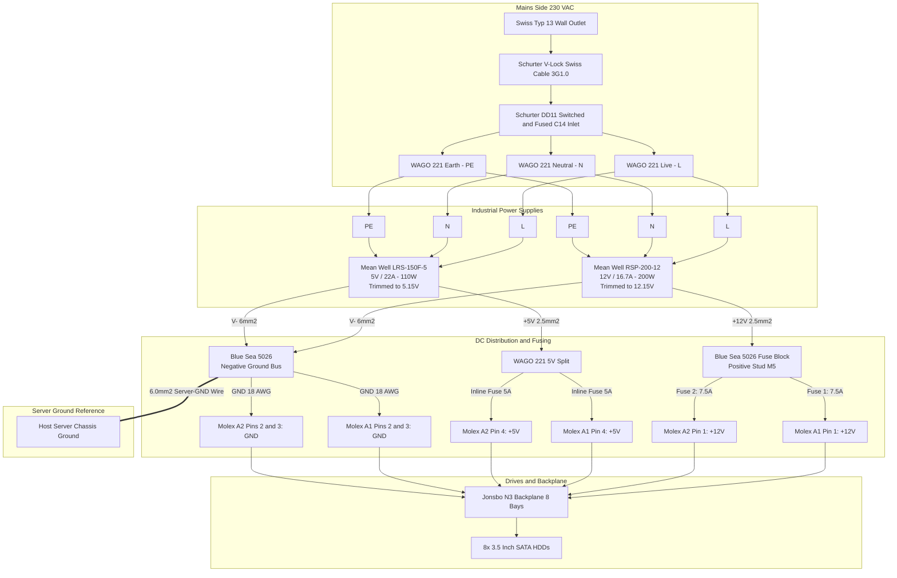
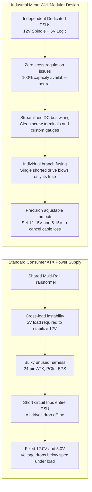
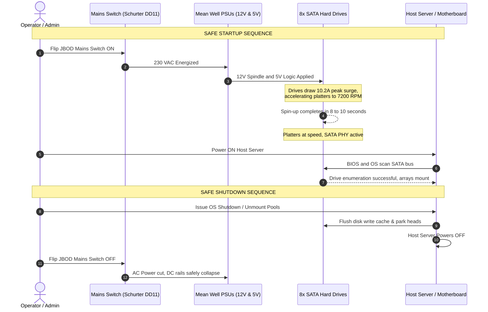

# DIY High-Density JBOD Power System

> [!CAUTION]
> ## UNTESTED EXPERIMENTAL DESIGN & STRICT LIMITATION OF LIABILITY
>
> **1. STATUS: THEORETICAL / UNTESTED PROOF OF CONCEPT (POC)**  
> The schematics, wiring instructions, Bill of Materials, calculations, and architectural designs in this repository represent a **theoretical and currently UNTESTED proof of concept**. The author has **NOT yet built, powered on, physically stress-tested, or lab-verified this build**. Sizing is derived strictly from calculations and manufacturer datasheets that may contain omissions or unmodeled real-world failure dynamics.
>
> **2. LETHAL MAINS VOLTAGE (230 VAC) & FIRE HAZARDS**  
> This project involves working directly with **mains electricity (100-240 VAC / 230 VAC)** and high-current direct-current (DC) power supplies. Mains voltage is **LETHAL** and presents severe risks of **fatal electrocution, arc flash, explosive component failure, and property-destroying fires**.
>
> **3. NO WARRANTY & ABSOLUTE LIMITATION OF LIABILITY ("AS IS")**  
> THIS REPOSITORY AND ALL ASSOCIATED DOCUMENTATION ARE PROVIDED **"AS IS", WITHOUT WARRANTY OF ANY KIND**, EXPRESS OR IMPLIED, INCLUDING BUT NOT LIMITED TO THE IMPLIED WARRANTIES OF MERCHANTABILITY, FITNESS FOR A PARTICULAR PURPOSE, OPERATIONAL SAFETY, OR NON-INFRINGEMENT.  
> **IN NO EVENT SHALL THE AUTHORS, MAINTAINERS, OR CONTRIBUTORS BE LIABLE FOR ANY CLAIM, DAMAGES, LOSS OF DATA, DESTRUCTION OF HARDWARE, PROPERTY DAMAGE, FIRE DAMAGE, PERSONAL INJURY, ELECTROCUTION, OR DEATH**, WHETHER IN AN ACTION OF CONTRACT, TORT (INCLUDING NEGLIGENCE), STRICT LIABILITY, OR OTHERWISE, ARISING OUT OF OR IN CONNECTION WITH THE ACCESS, USE, REPLICATION, MODIFICATION, OR IMPLEMENTATION OF THIS MATERIAL.
>
> **4. USER ASSUMES 100% OF ALL RISKS**  
> If you choose to replicate, adapt, construct, or energize any circuit described herein, **YOU DO SO AT YOUR OWN RISK**. You are solely responsible for compliance with all applicable local, regional, and national electrical codes and standards (e.g., SEV / NIN, VDE, NEC, CE, UL). Never work on energized circuits, and always have mains-voltage installations inspected by a licensed, certified electrician before applying power.

---

A well-documented, reproducible hardware guide for powering large arrays of 3.5" SATA hard drives (JBOD) using industrial **Mean Well switch-mode power supplies** instead of consumer ATX power supplies.

Designed for high reliability, clean voltage regulation, individual branch fuse protection, and common-ground reference with host servers.

---

## Navigation & Documentation

* **[Procurement & Sourcing Guide](docs/procurement_guide.md)**: Complete Bill of Materials (BOM), verified part numbers, pricing (CHF / EUR delivered to Bern, Switzerland), and consolidated distributor order lists.
* **[Electrical Calculations & Fusing](docs/electrical_calculations.md)**: Spin-up load calculations, continuous ampacity, fuse sizing (ATO/ATC blade fuses), wire cross-sections, and ground-loop prevention.
* **[Wiring & Assembly Guide](docs/wiring_and_assembly.md)**: Step-by-step bench assembly instructions, WAGO 221 AC mains split, voltage trimming (12.15 V / 5.15 V), and pre-flight commissioning checklist.
* **[Original Calculation Sheet (Digitized Markdown)](docs/original_calculation_sheet.md)**: Clean markdown conversion of the original worksheet, formulas, and busbar schematics.
* **[License & Legal Disclaimer](LICENSE)**: MIT License with strict limitation of liability and hardware safety terms.

---

## Project Overview: The 3 Power Supplies

This project standardizes on **three specific Mean Well industrial power supplies**:

1. **Mean Well RSP-200-12 (12 V / 16.7 A, 200.4 W):**
   * Role: Primary 12 V spindle supply for the **8 to 10 drive Proof of Concept**.
   * Features: Built-in active PFC (PF > 0.95), universal AC input (88-264 VAC), 1U low profile (30 mm), front trimmer (10.0-13.2 V).
   * Cold-start inrush: 40 A @ 230 VAC.
2. **Mean Well RSP-500-12 (12 V / 41.7 A, 500.4 W):**
   * Role: Scale-up 12 V supply for **30 drives per unit** (or 60 drives with two units).
   * Features: Built-in active PFC, built-in remote ON/OFF control, remote sense, front trimmer (10.0-13.2 V).
   * At 75% load target: Delivers 375 W continuous.
3. **Mean Well LRS-150F-5 (5 V / 22.0 A, 110.0 W):**
   * Role: Dedicated 5 V logic and backplane supply across all configurations.
   * Features: Full-range universal AC input ("F" model), front trimmer (4.5-5.5 V, tuned to 5.15 V).
   * At 75% load target: Powers up to 36 drive logic boards.

---

## System Architecture & Wiring Diagram

---

## ATX PSU vs. Industrial Mean Well Architecture

---

## Power Sequencing and Safe Boot Order

---

## Key Engineering Takeaways

1. **Why Not Consumer ATX PSUs?**  
   ATX power supplies require dummy load resistors on 5 V to prevent 12 V collapse under motor loads. Industrial Mean Well supplies provide rock-solid independent regulation and trimmers.
2. **Backplane Power Plane Behavior:**  
   On backplanes like the Jonsbo N3, both Molex headers share continuous internal 12 V and 5 V PCB planes. Feeding both headers from the **same** power supply pair distributes current evenly across pins. *Never connect two different power supplies to the two Molex ports on a single backplane without ORing isolation.*
3. **Common Ground is Mandatory:**  
   SATA data links are referenced to ground. The dedicated 6.0 mm2 bonding wire ties the JBOD negative bus and the server chassis together, preventing ground loops.
4. **Trimming for IR Drop:**  
   Tuning 5 V to **5.15 V** and 12 V to **12.15 V** at the PSU terminals guarantees that hard drives receive exactly 5.00 V and 12.00 V at the drive connectors under load.
