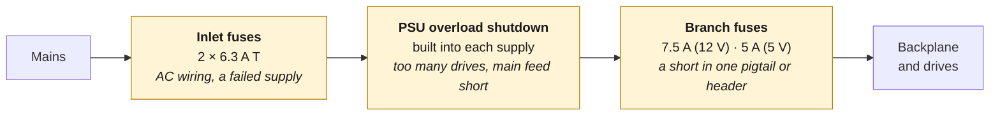
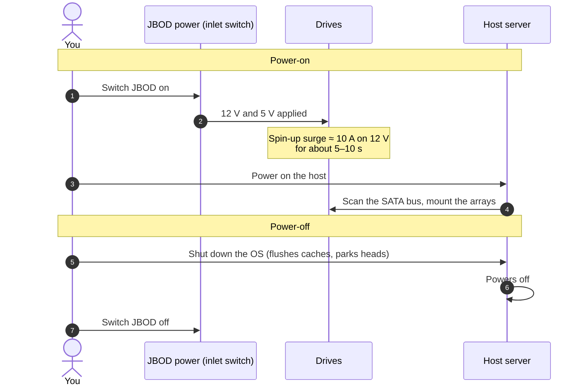

# 1. Design Overview

How the system fits together, and why it is built this way.

## The idea

The production drives are **WD Ultrastar DC HC530 14 TB** (SATA, 7200 rpm). Testing uses old, cheap, low-capacity drives, so a mistake costs nothing important. See [test drives](05-commissioning-checklist.md#e-first-spin-up-test-drives) for why they need a check first.

A hard drive needs two supplies: **+12 V** for the spindle motor and **+5 V** for the logic board. A JBOD backplane like the Jonsbo N3 takes both through two 4-pin Molex connectors and spreads them to all its bays.

This design uses one dedicated Mean Well supply per voltage:

| Supply | Output | Role |
|---|---|---|
| **Mean Well RSP-200-12** | 12 V, 16.7 A (200 W) | Spindle power for the 8-drive build. Active PFC, universal input, 40 A cold-start inrush at 230 VAC. |
| **Mean Well LRS-150F-5** | 5 V, 22 A (110 W) | Logic power. Universal input, no active PFC, 60 A cold-start inrush at 230 VAC. |
| **Mean Well RSP-500-12** *(scale-up)* | 12 V, 41.7 A (500 W) | Replaces the RSP-200-12 for larger arrays. Adds remote on/off and remote sense. See [Scaling up](06-scaling-up.md). |

Both supplies have a voltage-adjust trimmer (marked **V.ADJ**). It is used to set the outputs slightly high, at 12.15 V and 5.15 V, so the drives still see about 12.05 V and 5.10 V after the voltage drop in the wiring.

## System diagram

Every wire, in the colour you'll actually use:

### Why each part is there

- **Fused, switched inlet.** One switch disconnects both supplies on both poles, and the 6.3 A slow-blow fuses protect the internal AC wiring.
- **Blue Sea 5026 fuse block.** A common +12 V bus with up to 12 blade-fuse positions, plus a negative bus in the same housing. Each Molex lead gets its own fuse, so a shorted pigtail blows only its own fuse.
- **5 V fused separately.** The fuse block has a single positive bus, so it can carry only one voltage. The 5 V leads use two inline blade-fuse holders off a lever-nut split instead.
- **Both Molex headers on one backplane come from the same pair of supplies.** On the Jonsbo N3 both headers feed the same internal 12 V and 5 V copper planes, so the current splits roughly evenly between them. **Never** feed the two headers of one backplane from two different supplies: their outputs would be tied together and would fight each other.
- **Power Disable (PWDIS) is not an issue.** Enterprise SATA drives like the HC530 stay switched off if 3.3 V reaches pin 3 of their SATA power connector. The backplane is fed through 4-pin Molex, which carries no 3.3 V, so this build avoids the problem. It only matters if you power a drive another way, for example with an ATX supply's SATA cables.
- **Ground bond to the server.** Mean Well supplies have isolated outputs, which means their V− terminal is not connected to earth, so the JBOD's 0 V would otherwise float relative to the server. The bond wire gives the drives and the SATA controller the same 0 V reference. Then the SATA cable ground wires never have to carry an offset current, and a static or fault charge has a proper path.

### What protects what

Each protective device covers the part of the circuit downstream of it. If something fails, look at the first device upstream of the fault:

Each yellow box lists what it protects against, in italics.

A short on the backplane itself sits behind **both** branch fuses of that rail, because the two headers share one copper plane. Either fuse, or both, may blow.

## Why not an ATX power supply?

An ATX supply works. Many JBODs run on one. This design trades a little cost and effort for some specific advantages:

| | Consumer ATX PSU | This design |
|---|---|---|
| **Fault isolation** | One short trips the whole PSU, so every drive goes offline at once | A short blows only that branch's fuse |
| **Voltage tuning** | Fixed outputs | Each rail is trimmable to make up for wiring loss |
| **Wiring** | Bulky harness with unused 24-pin, PCIe and EPS cables | Only the wires you need, sized for the job |
| **Turning on** | Needs PS_ON bridged or an adapter board | Turns on with the mains switch (the RSP-500-12 also has a remote on/off input) |
| **Rail balance** | Older group-regulated units can drift on 12 V with little 5 V load. Modern DC-DC designs don't have this problem | The rails are independent supplies |
| **Cost and effort** | Cheap, plug-and-play | More parts, and you have to wire mains yourself |

## Power-on and power-off order

The drives should be spinning before the host scans for them, and the host should be shut down cleanly before the drives lose power.

If the host is already running when you switch on the JBOD, the drives appear as hot-plugged devices. That works with most HBAs and AHCI controllers that have hot-plug enabled, but powering on first is the predictable order.

Next: [Bill of materials](02-bill-of-materials.md)
