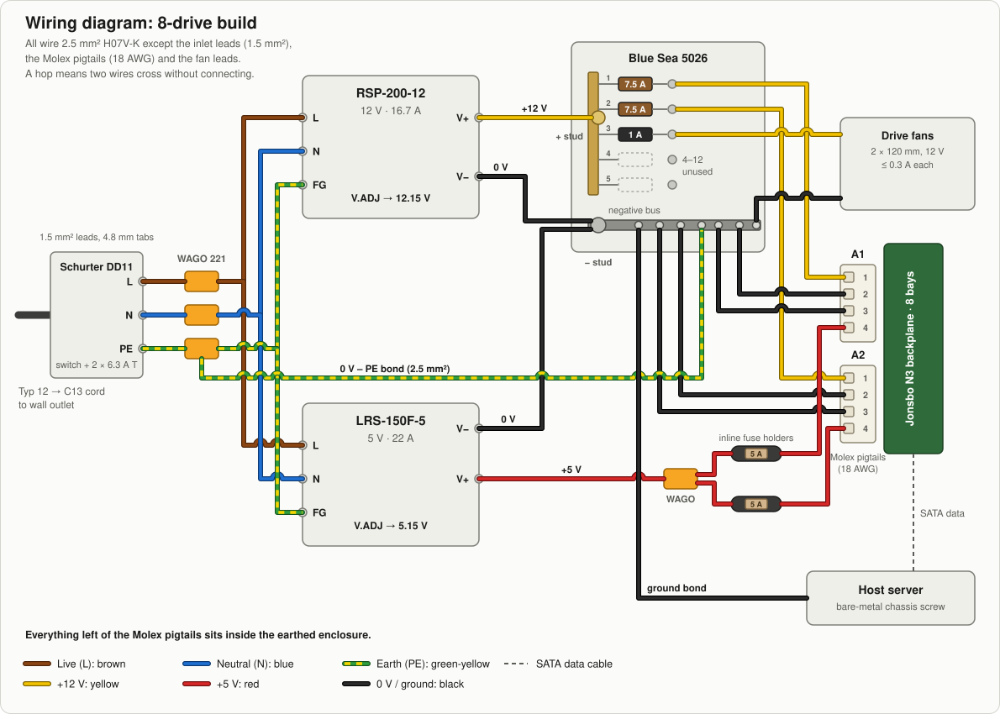
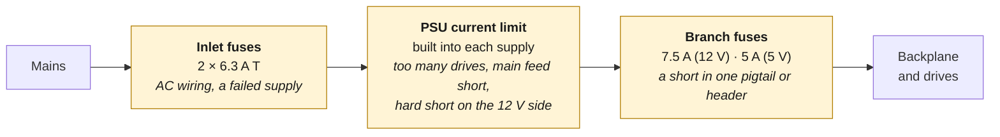
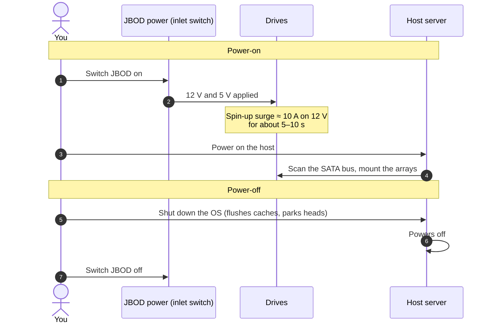

# 1. Design Overview

How the system fits together, and why it is built this way.

## The idea

The production drives are **WD Ultrastar DC HC530 14 TB** (SATA, 7200 rpm). Testing uses old, cheap, low-capacity drives, so a mistake costs nothing important. See [test drives](05-commissioning-checklist.md#e-first-spin-up-test-drives) for why they need a check first.

A hard drive needs two supplies: **+12 V** for the spindle motor and **+5 V** for the logic board. A JBOD backplane like the Jonsbo N3 takes both through two 4-pin Molex connectors and spreads them to all its bays.

This design uses one dedicated Mean Well supply per voltage:

| Supply | Output | Role |
|---|---|---|
| **Mean Well RSP-200-12** | 12 V, 16.7 A (200 W) | Spindle power for the 8-drive build. Active PFC, universal input, 40 A cold-start inrush at 230 VAC. |
| **Mean Well LRS-150F-5** | 5 V, 22 A (110 W) | Logic power. Universal input, no active PFC, 60 A cold-start inrush at 230 VAC. |
| **Mean Well RSP-500-12** *(scale-up)* | 12 V, 41.7 A (500 W) | Replaces the RSP-200-12 for larger arrays. Adds remote on/off and remote sense. See [Scaling up](06-scaling-up.md). |

Both supplies have a voltage-adjust trimmer (marked **V.ADJ**). It is used to set the outputs slightly high, at 12.15 V and 5.15 V, so the drives still see about 12.0 V and 5.05 V at the spin-up peak, after the voltage drop in the wiring and fuses. See [Electrical calculations](03-electrical-calculations.md#wire-sizes-and-voltage-drop).

## System diagram

Every wire, in the colour you'll actually use:

### Why each part is there

- **Earthed enclosure.** Everything from the inlet to the fuse block sits on an insulating board inside a closed, earthed metal enclosure (for example an empty 19″ 2U case). The inlet is fitted in its rear wall, and the pigtails, fan leads and server bond leave through grommets. Nothing carrying 230 VAC can be touched.
- **Fused, switched inlet.** One switch disconnects both supplies on both poles, and the 6.3 A slow-blow fuses protect the internal AC wiring.
- **Blue Sea 5026 fuse block.** A common +12 V bus with up to 12 blade-fuse positions, plus a negative bus in the same housing. Each Molex lead gets its own fuse, so a shorted pigtail blows only its own fuse. Position 3 feeds the drive fans through a 1 A fuse.
- **5 V fused separately.** The fuse block has a single positive bus, so it can carry only one voltage. The 5 V leads use two inline blade-fuse holders off a lever-nut split instead.
- **Both Molex headers on one backplane come from the same pair of supplies.** The design assumes that the Jonsbo N3 ties both headers to the same internal 12 V and 5 V copper planes, so the current splits roughly evenly between them. This is **not verified yet**: the commissioning checklist measures it ([step B](05-commissioning-checklist.md#b-resistance-checks-unplugged)). **Never** feed the two headers of one backplane from two different supplies: if the planes are shared, their outputs would be tied together and would fight each other.
- **A blown branch fuse can go unnoticed.** With shared planes, if one +12 V fuse blows the drives keep running from the other header. At the next power-on that one fuse carries the whole 10.16 A spin-up current, 135 % of its 7.5 A rating, and may blow too. Check both fuses after any fault, or fit blade fuses with a built-in "blown" LED.
- **Power Disable (PWDIS) should not be an issue.** Enterprise SATA drives like the HC530 stay switched off if 3.3 V reaches pin 3 of their SATA power connector. Molex carries no 3.3 V, so this build is safe *unless the backplane makes its own 3.3 V*. The commissioning checklist measures this before any drive goes in ([step D2](05-commissioning-checklist.md#d2-backplane-check-no-drives)). PWDIS also matters if you power a drive another way, for example with an ATX supply's SATA cables.
- **0 V bonded to earth, and to the server.** Mean Well supplies have isolated outputs: their V− terminal is not connected to earth. This build connects the negative bus to PE inside the JBOD, as an ATX supply does internally, so the JBOD's 0 V never floats. A second wire bonds the negative bus to the server's chassis, so the drives and the SATA controller share one 0 V reference. With both in place, the thin ground wires in the SATA data cables never carry an offset or fault current, even if one bond comes loose. The loop this forms through the mains earth is harmless: at DC it carries no current. **Connect the server bond before any SATA data cable, and disconnect it last.**
- **Cooling.** Eight 7200 rpm drives packed into a backplane cage get hot without airflow; the HC530 is rated for 60 °C at most. Two 12 V fans, fused at 1 A on the fuse block, blow across the drives. If the backplane sits in a case whose fans you can feed from this circuit (for example the Jonsbo N3 case), use those instead.

### What protects what

Each protective device covers the part of the circuit downstream of it. If something fails, look at the first device upstream of the fault:

Each yellow box lists what it protects against, in italics.

A short on the backplane itself sits behind **both** branch fuses of that rail, because the two headers share one copper plane. Either fuse, or both, may blow.

On +12 V a hard short is not hundreds of amps: the RSP-200-12 limits its output to about 17.5–22.5 A and then switches off and retries ("hiccup"). That is only 2.3–3 × the 7.5 A fuse rating, which takes up to a few seconds to blow, so the supply often cuts out first. **A 12 V short usually shows up as the supply clicking on and off, not as a blown fuse.** The wiring is still safe, because 2.5 mm² wire carries 22.5 A easily and the 18 AWG pigtails survive the short bursts. The fuses do the main job on overloads between about 7.5 and 17 A, for example a drive with a damaged motor. On +5 V the LRS-150F-5 delivers 24–31 A into a short, 5–6 × the 5 A fuse, so those fuses blow quickly.

## Why not an ATX power supply?

An ATX supply works. Many JBODs run on one. This design trades a little cost and effort for some specific advantages:

| | Consumer ATX PSU | This design |
|---|---|---|
| **Fault isolation** | One short trips the whole PSU, so every drive goes offline at once | A short in one pigtail blows only its own fuse. A short on the backplane or in a drive takes down that whole backplane, as with ATX |
| **Voltage tuning** | Fixed outputs | Each rail is trimmable to make up for wiring loss |
| **Wiring** | Bulky harness with unused 24-pin, PCIe and EPS cables | Only the wires you need, sized for the job |
| **Turning on** | Needs PS_ON bridged or an adapter board | Turns on with the mains switch (the RSP-500-12 also has a remote on/off input) |
| **Rail balance** | Older group-regulated units can drift on 12 V with little 5 V load. Modern DC-DC designs don't have this problem | The rails are independent supplies |
| **Cost and effort** | Cheap, plug-and-play | More parts, and you have to wire mains yourself |

## Power-on and power-off order

The drives should be spinning before the host scans for them, and the host should be shut down cleanly before the drives lose power.

If the host is already running when you switch on the JBOD, the drives appear as hot-plugged devices. That works with most HBAs and AHCI controllers that have hot-plug enabled, but powering on first is the predictable order.

Next: [Bill of materials](02-bill-of-materials.md)
