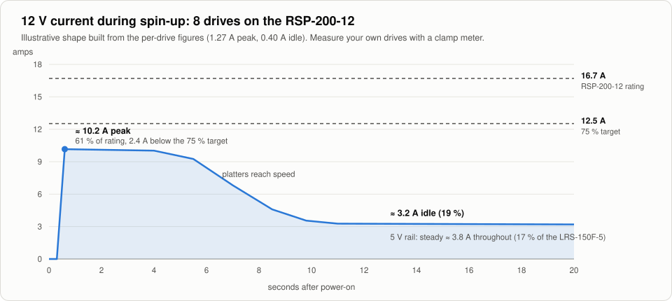
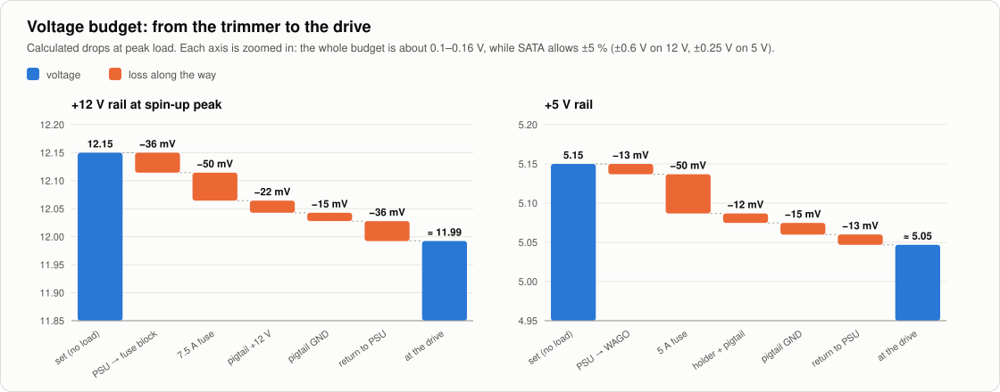
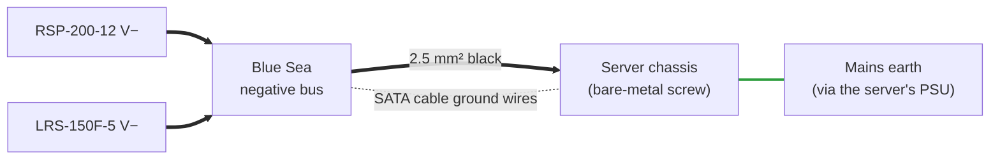

# 3. Electrical Calculations

Load, fuse and wire sizing for the 8-drive build. To redo any of this for a different drive or drive count, run `python3 tools/jbod_power.py --help`.

## Assumptions

| Per 3.5″ drive | Value | Notes |
|---|---|---|
| 12 V spin-up current | **1.27 A** (15.2 W) | Lasts about 5–10 s from power-on |
| 12 V idle / operating current | **0.40 A** (4.8 W) | Typical range is 0.35–0.45 A |
| 5 V current | **0.47 A** (2.4 W) | Treated as constant |
| Derating target | **75 %** of the PSU's rated output | Keeps the supplies cool and long-lived |

> [!IMPORTANT]
> These are typical 7200 rpm figures. **Look up your drives' datasheet.** High-capacity helium drives often list 1.8–2.0 A at 12 V spin-up, which changes everything below.

## Load: 8 drives

| Rail | Peak | Supply | Rating | Load | Status |
|---|---|---|---|---|---|
| +12 V spin-up | 8 × 1.27 A = **10.16 A** (122 W) | RSP-200-12 | 16.7 A | **60.8 %** | ✅ within 75 % |
| +12 V idle | 8 × 0.40 A = **3.2 A** (38 W) | RSP-200-12 | 16.7 A | 19.2 % | ✅ |
| +5 V | 8 × 0.47 A = **3.76 A** (19 W) | LRS-150F-5 | 22 A | **17.1 %** | ✅ |
| **Total peak** | **141 W** | | | | |

Within the 75 % target, the RSP-200-12 handles at most **9 drives** spinning up together (10 drives is 76 %). The LRS-150F-5 handles **35 drives**.

## Branch fuses

The Jonsbo N3 has two Molex headers, **A1** and **A2**, which feed the same internal power planes. Each header therefore carries about half the load.

| Lead | Peak current per header | Fuse | Why this rating |
|---|---|---|---|
| +12 V (yellow) | 10.16 A ÷ 2 = **5.08 A** | **7.5 A** ATO/ATC | The smallest standard rating ≥ 1.25 × peak. Far below what 18 AWG pigtail wire can carry, so it blows before the wire overheats. |
| +5 V (red) | 3.76 A ÷ 2 = **1.88 A** | **5 A** ATO/ATC | 3 A would be the minimum. 5 A leaves room for the capacitor inrush when a drive is hot-inserted and is still well within the wire's limit. |

Blade fuses carry their rated current indefinitely and take seconds to minutes to blow at 135–200 % of rating. A 5 A spin-up surge on a 7.5 A fuse is therefore no problem, while a hard short (hundreds of amps) clears in milliseconds.

**Ground leads are not fused.** That is normal, because a fuse in the return path does not protect anything.

## Wire sizes and voltage drop

The voltage drop in one conductor is

$$\Delta V = I \cdot \frac{\rho \cdot L}{A}, \qquad \rho_{\text{Cu}} = 0.0175\ \Omega\,\text{mm}^2/\text{m}$$

| Segment | Wire | Length | Current (peak) | Drop |
|---|---|---|---|---|
| RSP-200-12 V+ → fuse block | 2.5 mm² | 0.5 m | 10.16 A | 0.036 V |
| Fuse block → Molex +12 V | 18 AWG (0.82 mm²) | 0.2 m | 5.08 A | 0.022 V |
| Molex GND → negative bus (2 wires per pigtail) | 18 AWG | 0.2 m | 3.48 A each | 0.015 V |
| Negative bus → RSP-200-12 V− | 2.5 mm² | 0.5 m | 10.16 A | 0.036 V |
| **12 V round trip, wire only** | | | | **≈ 0.11 V** |
| LRS-150F-5 V+ → WAGO split | 2.5 mm² | 0.5 m | 3.76 A | 0.013 V |
| WAGO → fuse holder → Molex +5 V | 18 AWG | ~0.3 m | 1.88 A | 0.012 V |
| Molex GND (shared, see above) | 18 AWG | 0.2 m | | 0.015 V |
| Negative bus → LRS-150F-5 V− | 2.5 mm² | 0.5 m | 3.76 A | 0.013 V |
| **5 V round trip, wire only** | | | | **≈ 0.05 V** |

Add roughly **0.05 V per fuse** and a little for each crimp and the Molex contacts. Put together:

2.5 mm² wire is rated about 24 A, so every 2.5 mm² run here has at least 2× headroom. Earlier versions of this design used 6 mm² for the returns. That isn't needed at these currents, and it would not fit the PSU terminal blocks well.

### Setting the trimmers

Set the outputs with **no drives connected**, measuring at the Molex pigtail:

| Rail | Set to (no load) | Expected at the drives during spin-up | SATA tolerance (±5 %) |
|---|---|---|---|
| +12 V | **12.15 V** | ≈ 11.95–12.05 V | 11.40–12.60 V |
| +5 V | **5.15 V** | ≈ 5.05–5.10 V | 4.75–5.25 V |

## Ground bond to the server

Without the bond wire, the dotted path (the thin ground wires inside the SATA cables) would be the only connection between the two 0 V references.

Mean Well outputs are isolated, so V− has no connection to earth. Without the bond, the JBOD's 0 V floats relative to the server's 0 V, which is tied to chassis and earth. The only link between them would then be the thin ground wires inside the SATA cables. The bond wire:

- gives the drives and the host controller one common 0 V reference,
- keeps the SATA cable grounds from carrying offset or fault current,
- and through the server's chassis ties the JBOD's DC side to earth.

In normal operation it carries almost no current, so 2.5 mm² is plenty.

Next: [Assembly guide](04-assembly-guide.md)
