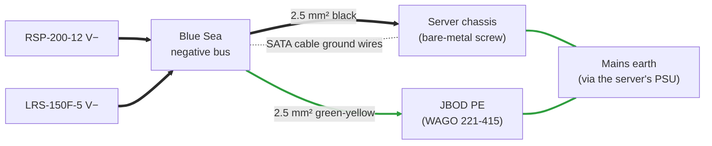

# 3. Electrical Calculations

Load, fuse and wire sizing for the 8-drive build. To redo any of this for a different drive or drive count, run `python3 tools/jbod_power.py --help`.

## Assumptions

The production drive is the **WD Ultrastar DC HC530 14 TB SATA** (`WUH721414ALE6L4`). The figures below are its datasheet values:

| Per drive | Value | Notes |
|---|---|---|
| 12 V spin-up current | **1.27 A** (15.2 W) | Peak, from the HC530 OEM spec. Lasts about 5–10 s from power-on. |
| 12 V idle / operating current | **0.40 A** (4.8 W) | Conservative. The datasheet gives ≈ 5.5 W idle and ≈ 6 W operating for the whole drive, both rails together. |
| 5 V current | **0.47 A** (2.4 W) | Peak, from the HC530 OEM spec. Treated as constant. |
| Derating target | **75 %** of the PSU's rated output | Keeps the supplies cool and long-lived |

> [!IMPORTANT]
> **The drive label shows running current, not spin-up current.** The HC530 label says "5VDC 0.44A, 12VDC 0.57A", but it draws 1.27 A at 12 V while spinning up. Size the supply and fuses from the datasheet's *startup* figure.
>
> If you use a different drive, look up its datasheet and run `python3 tools/jbod_power.py --spinup-12v <amps> --logic-5v <amps>`. Older and desktop 7200 rpm drives often need **2–2.8 A** at 12 V to spin up.

## Load: 8 drives

| Rail | Peak | Supply | Rating | Load | Status |
|---|---|---|---|---|---|
| +12 V spin-up | 8 × 1.27 A = **10.16 A** (122 W) | RSP-200-12 | 16.7 A | **60.8 %** | ✅ within 75 % |
| +12 V idle | 8 × 0.40 A = **3.2 A** (38 W) | RSP-200-12 | 16.7 A | 19.2 % | ✅ |
| +5 V | 8 × 0.47 A = **3.76 A** (19 W) | LRS-150F-5 | 22 A | **17.1 %** | ✅ |
| **Total peak** | **141 W** | | | | |

Within the 75 % target, the RSP-200-12 handles at most **9 drives** spinning up together (10 drives is 76 %). The LRS-150F-5 handles **35 drives**.

The two drive fans add up to 2 × 0.3 A = 0.6 A on 12 V: 10.16 + 0.6 = **10.76 A (64.4 %)** at spin-up and 3.8 A at idle. Still well within the target. Use `--extra-12v 0.6` in the calculator to include them.

## Branch fuses

The Jonsbo N3 has two Molex headers, **A1** and **A2**, which feed the same internal power planes. Each header therefore carries about half the load.

| Lead | Peak current per header | Fuse | Why this rating |
|---|---|---|---|
| +12 V (yellow) | 10.16 A ÷ 2 = **5.08 A** | **7.5 A** ATO/ATC | The smallest standard rating ≥ 1.25 × peak. Far below what 18 AWG pigtail wire can carry, so it blows before the wire overheats. |
| +5 V (red) | 3.76 A ÷ 2 = **1.88 A** | **5 A** ATO/ATC | 3 A would be the minimum. 5 A leaves room for the capacitor inrush when a drive is hot-inserted and is still well within the wire's limit. |
| Fans (yellow 0.75 mm²) | 2 × 0.3 A = **0.6 A** | **1 A** ATO/ATC, position 3 | 1.25 × 0.6 = 0.75 A, so 1 A. Also protects the fans' own thin (≈ 24 AWG) leads. |

The 18 AWG pigtails should never get a fuse above **10 A**. If your drives need more than that per header (above 2.0 A spin-up per drive with 8 drives: 4 × 2.0 A × 1.25 = 10 A), the calculator says so: use fewer drives per backplane, staggered spin-up or thicker wire.

Blade fuses carry their rated current indefinitely and take seconds to minutes to blow at 135–200 % of rating, and about 0.15–5 s at 200 %. A 5.08 A spin-up surge on a 7.5 A fuse (68 %) is therefore no problem.

**What a short really does.** A switch-mode supply doesn't deliver hundreds of amps into a short. It limits its current and then switches off and retries ("hiccup" mode):

| Supply | Current into a short | Multiple of the branch fuse | Result |
|---|---|---|---|
| RSP-200-12 | 16.7 A × 105–135 % = **17.5–22.5 A** | 2.3–3.0 × 7.5 A | The fuse may take seconds, so the supply often hiccups first. Expect clicking, not a blown fuse. |
| LRS-150F-5 | 22 A × 110–140 % = **24–31 A** | 4.8–6.2 × 5 A | The fuse blows quickly. |

Every conductor still survives this: 2.5 mm² carries 22.5 A continuously, and the 18 AWG pigtails only see it in short bursts. The 12 V branch fuses protect against the overloads in between (about 7.5–17 A) that the supply would happily deliver forever.

**One blown fuse.** If the two headers share the backplane's copper planes, a blown +12 V fuse leaves the other carrying everything. At idle that is 3.2 A, no problem, but at the next spin-up it is 10.16 A ÷ 7.5 A = **135 %** for 5–10 s, which may blow it too. Check both fuses after any fault.

**Ground leads are not fused.** That is normal, because a fuse in the return path does not protect anything.

## Wire sizes and voltage drop

The voltage drop in one conductor is

$$\Delta V = I \cdot \frac{\rho \cdot L}{A}, \qquad \rho_{\text{Cu}} = 0.0175\ \Omega\,\text{mm}^2/\text{m}$$

| Segment | Wire | Length | Current (peak) | Drop |
|---|---|---|---|---|
| RSP-200-12 V+ → fuse block | 2.5 mm² | 0.5 m | 10.16 A | 0.036 V |
| Fuse block → Molex +12 V | 18 AWG (0.82 mm²) | 0.2 m | 5.08 A | 0.022 V |
| Molex GND → negative bus (2 wires per pigtail) | 18 AWG | 0.2 m | 3.48 A each | 0.015 V |
| Negative bus → RSP-200-12 V− | 2.5 mm² | 0.5 m | 10.16 A | 0.036 V |
| **12 V round trip, wire only** | | | | **≈ 0.11 V** |
| LRS-150F-5 V+ → WAGO split | 2.5 mm² | 0.5 m | 3.76 A | 0.013 V |
| WAGO → fuse holder → Molex +5 V | 18 AWG | ~0.3 m | 1.88 A | 0.012 V |
| Molex GND (shared, see above) | 18 AWG | 0.2 m | | 0.015 V |
| Negative bus → LRS-150F-5 V− | 2.5 mm² | 0.5 m | 3.76 A | 0.013 V |
| **5 V round trip, wire only** | | | | **≈ 0.05 V** |

Add roughly **0.05 V per fuse** and a little for each crimp and the Molex contacts. Put together:

2.5 mm² wire is rated about 24 A, so every 2.5 mm² run here has at least 2× headroom. Earlier versions of this design used 6 mm² for the returns. That isn't needed at these currents, and it would not fit the PSU terminal blocks well.

### Setting the trimmers

Set the outputs with **no drives connected**, measuring at the Molex pigtail:

| Rail | Set to (no load) | Expected at the drives during spin-up | SATA tolerance (±5 %) |
|---|---|---|---|
| +12 V | **12.15 V** | ≈ 12.0 V (12.15 − 0.16 = 11.99 V) | 11.40–12.60 V |
| +5 V | **5.15 V** | ≈ 5.05 V (5.15 − 0.10 = 5.05 V) | 4.75–5.25 V |

At idle the 12 V current is about a third of the spin-up peak, so the drives see about 12.1 V. The 5 V load hardly changes.

## Ground bond to the server

Without the bond wires, the dotted path (the thin ground wires inside the SATA cables) would be the only connection between the two 0 V references.

Mean Well outputs are isolated, so V− has no connection to earth. Left alone, the JBOD's 0 V would float relative to the server's 0 V, which is tied to chassis and earth. Two bonds fix that:

- **Negative bus → JBOD PE** (green-yellow, to the PE lever nut). The JBOD's 0 V is earthed locally, as in an ATX supply, even when the server bond is unplugged.
- **Negative bus → server chassis** (black). The drives and the host controller share one 0 V reference, so the SATA cable grounds never carry offset or fault current.

These form a loop through the mains earth (JBOD PE → wall socket → server PE → chassis → bond). At DC that loop carries no current, and it is the same loop any two earthed computers joined by a cable form.

**Why it matters:** if +12 V ever touches the server's chassis, the fault current (up to about 22.5 A, the supply's current limit) returns through the bonds. Without them it would take the 26–30 AWG ground wires in the SATA data cables, which would burn. The bonds normally carry almost no current, and 2.5 mm² easily carries the 22.5 A fault current.

**Connect the server bond before any SATA data cable, and disconnect it last.**

Next: [Assembly guide](04-assembly-guide.md)
