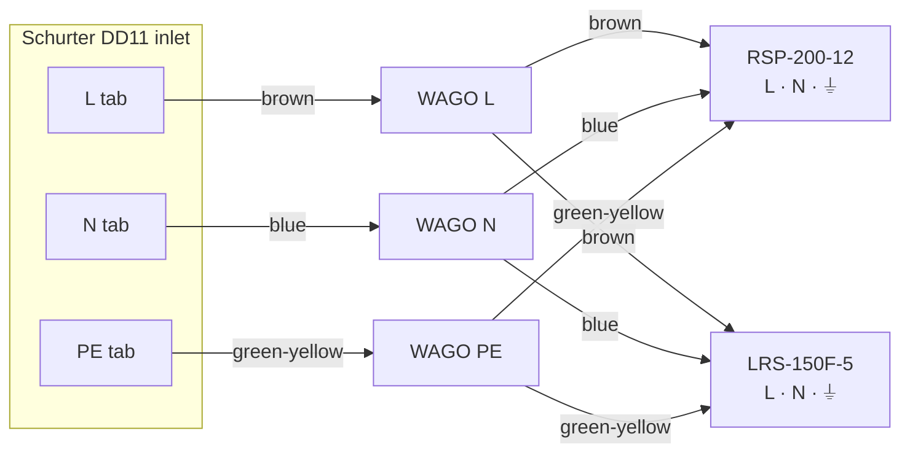

# 4. Assembly Guide

Step-by-step wiring for the 8-drive build. Parts are named as in the [bill of materials](02-bill-of-materials.md).

> [!CAUTION]
> Untested design. **Keep the mains cord unplugged for this entire guide.** Read [SAFETY.md](../SAFETY.md) first.

## Tools

- Wire stripper for 0.5–2.5 mm²
- Ferrule crimper (from the kit) and an insulated-terminal crimper for ring and fork terminals
- Small flat screwdriver for the PSU terminals and trimmers, and a PH2 screwdriver
- 3/8″ (≈ 9.5 mm) nut driver or spanner for the Blue Sea #10-32 studs
- Heat gun. A lighter will scorch adhesive heat shrink.
- Multimeter that reads 0.01 V

## Wire colours

| Function | Colour |
|---|---|
| AC live (L) | Brown |
| AC neutral (N) | Blue |
| Protective earth (PE) | Green-yellow, and nothing else |
| +12 V | Yellow (matches the Molex pigtail) |
| +5 V | Red (matches the Molex pigtail) |
| 0 V / ground | Black |

Use a **ferrule** on every stranded wire end that goes into a lever nut or a screw clamp, and a **ring terminal** on every wire end that goes onto a stud.

---

## Step 1: Mounting

1. Mount both supplies and the Blue Sea 5026 on an **insulating board**, for example 300 × 200 mm of plywood, phenolic or acrylic. Leave at least 20 mm around the supplies for airflow.
2. The Schurter inlet is a **panel-mount** part and needs a rectangular cutout in a panel (check the DD11 datasheet for the size). A small upright bracket on the board works. **If the bracket or enclosure is metal, connect it to PE.**
3. Never run the build loose on a metal desk.

Neither supply has a 115/230 V selector switch. Both accept 88–264 VAC automatically.

## Step 2: Prepare the Molex pigtails

Cut **one** InLine 33445 Y-cable just behind each of its two female connectors, so you have two female pigtails with about 20 cm of wire each. Keep the second cable as a spare. Strip 8 mm from each wire.

| Pin | Wire | Function |
|---|---|---|
| 1 | Yellow | +12 V |
| 2 | Black | GND |
| 3 | Black | GND |
| 4 | Red | +5 V |

> [!WARNING]
> Not every cable maker follows the colour code. **Check with the multimeter's continuity mode** that yellow really goes to pin 1 and red to pin 4. Pin 1 is at the chamfered corner of the connector.

Label one pigtail **A1** and the other **A2**.

## Step 3: AC wiring (230 VAC)



1. Fit **two 6.3 A slow-blow (T) 5×20 mm fuses** in the Schurter 4301.1401 drawer and slide it into the inlet.
2. Crimp insulated 6.3 mm push-on receptacles onto three short 2.5 mm² wires (brown, blue, green-yellow) and push them onto the inlet's **L**, **N** and **PE** tabs.
3. Put each wire into its own 3-way WAGO 221-413. From each WAGO, run one wire of the same colour to each supply:
   - brown → **L** on both supplies
   - blue → **N** on both supplies
   - green-yellow → **⏚ / FG** on both supplies
4. Tug-test every wire, then close the WAGO levers fully.
5. Fit the terminal covers on both supplies if they came with them.

## Step 4: +12 V distribution

1. Run a **yellow 2.5 mm²** wire from **RSP-200-12 V+** (fork or ring terminal) to the **positive main stud** of the Blue Sea 5026 (M5 ring terminal). Torque to the value printed on the block, about 2.7 N·m.
2. Crimp an **M4 red ring terminal** on the yellow wire of pigtail A1 and connect it to **branch 1**. Do the same with A2 on **branch 2**.
3. Insert a **7.5 A** blade fuse in positions 1 and 2. Leave all other positions empty.

## Step 5: +5 V distribution

The fuse block's bus carries only +12 V, so +5 V uses inline fuse holders:

```
LRS-150F-5 V+ ──red 2.5 mm²──► WAGO ──► fuse holder (5 A) ──► WAGO ──► red wire, pigtail A1
                                     └─► fuse holder (5 A) ──► WAGO ──► red wire, pigtail A2
```

1. Run a **red 2.5 mm²** wire from **LRS-150F-5 V+** to a 3-way WAGO.
2. Put one lead of each inline fuse holder into that WAGO.
3. Join each fuse holder's other lead to the red wire of one pigtail with a WAGO. One slot stays empty; close its lever anyway. A crimped butt splice under heat shrink also works.
4. Insert a **5 A** fuse in each holder.

## Step 6: Ground returns and server bond

1. Run a **black 2.5 mm²** wire from **RSP-200-12 V−** to the **negative bus stud** of the Blue Sea 5026 (M5 ring).
2. Run a **black 2.5 mm²** wire from **LRS-150F-5 V−** to the same stud.
3. Connect the **two black wires of each pigtail** (four in total) to the negative bus branch screws (M4 red rings).
4. **Server bond:** crimp an M5 ring onto a black 2.5 mm² wire long enough to reach your server, and bolt it to the negative bus stud. Crimp a blue M4 ring on the other end. This end is connected to a bare-metal chassis screw on the server during [commissioning](05-commissioning-checklist.md). Scrape off paint if needed.

## Step 7: Finish

- Shrink adhesive heat shrink over every crimp barrel and splice.
- Clip on the fuse block cover.
- Strain-relieve the pigtails and the server bond wire with cable ties, so a tug on them doesn't pull on the terminals.
- Label the inlet "230 VAC".

Next: [Commissioning checklist](05-commissioning-checklist.md). Do it in full before you connect any drive.
