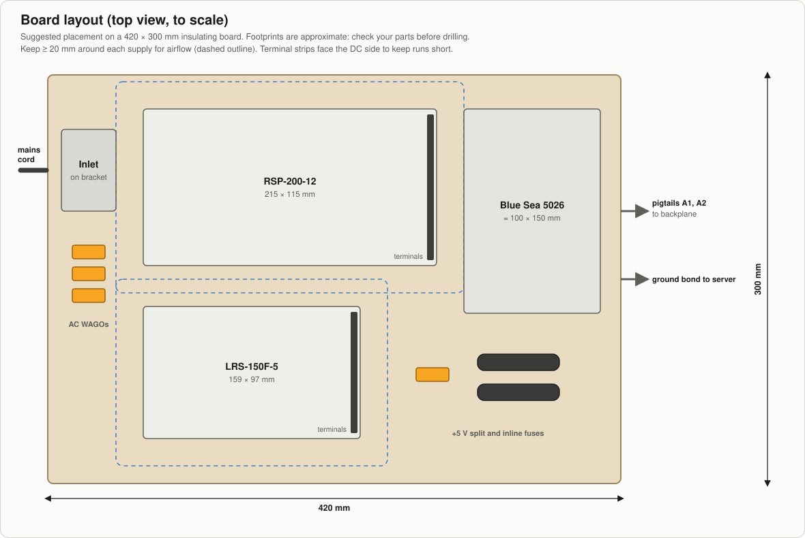
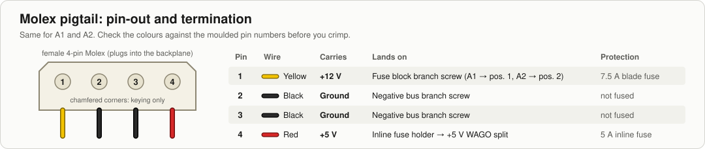
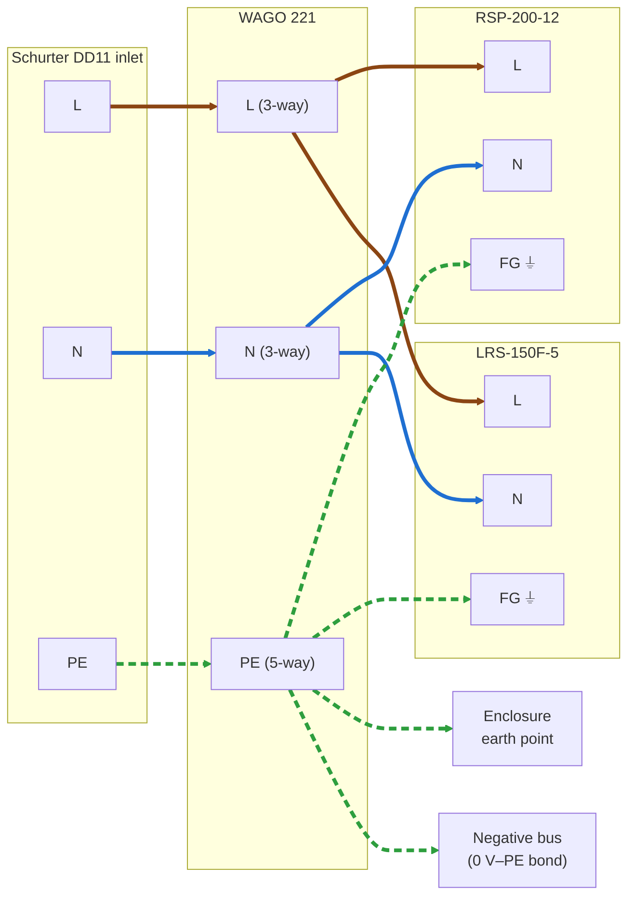
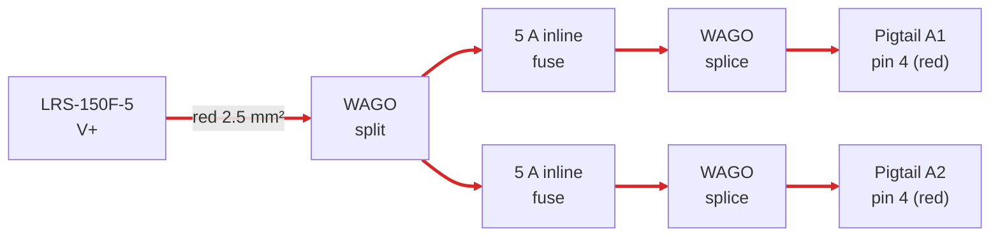

# 4. Assembly Guide

Step-by-step wiring for the 8-drive build. Parts are named as in the [bill of materials](02-bill-of-materials.md).

> [!CAUTION]
> Untested design. **Keep the mains cord unplugged for this entire guide.** Read [SAFETY.md](../SAFETY.md) first.

The complete wiring diagram, for reference while you work:

## Tools

The tools listed under "Not included" in the [bill of materials](02-bill-of-materials.md), plus the **insulated trimming tool** from Order 2:

- Wire stripper for 0.5–2.5 mm²
- Ferrule crimper (from the kit), and a ratchet crimper for insulated ring, fork and flat push-on terminals
- Small flat screwdriver for the PSU terminals, and a PH2 screwdriver
- Insulated (plastic) trimming tool for the V.ADJ trimmers
- 3/8″ (≈ 9.5 mm) nut driver or spanner for the Blue Sea #10-32 studs
- Heat gun. A lighter will scorch adhesive heat shrink.
- Drill, and a jigsaw, nibbler or file for the inlet cutout
- Multimeter that reads 0.01 V and has MIN/MAX

## Wire colours

| Function | Colour |
|---|---|
| AC live (L) | Brown |
| AC neutral (N) | Blue |
| Protective earth (PE), including the enclosure earth and the 0 V–PE bond | Green-yellow, and nothing else |
| +12 V | Yellow (matches the Molex pigtail) |
| +5 V | Red (matches the Molex pigtail) |
| 0 V / ground, server bond | Black |

Use a **ferrule** on every stranded wire end that goes into a lever nut or a screw clamp, and a **ring terminal** on every wire end that goes onto a stud or a fuse block screw.

---

## Step 1: Enclosure and mounting

1. Mount both supplies and the Blue Sea 5026 on an **insulating board** of about **420 × 300 mm** (plywood, phenolic or acrylic) with screws and nylon standoffs. The RSP-200-12 alone is 215 × 115 mm. Leave at least 20 mm around the supplies for airflow, and face their terminal strips toward the fuse block to keep the DC runs short.
2. The board goes inside the **metal enclosure** (e.g. an empty 19″ 2U case). Make sure the enclosure has vent holes near the supplies.
3. Cut the **inlet cutout** in the enclosure's rear panel to the size in the [DD11 datasheet](https://www.schurter.com/en/datasheet/typ_dd11.pdf), deburr it, and fit the Schurter inlet so the cord plugs in from outside.
4. **Earth point:** drill an M4 hole in a bare-metal spot of the enclosure near the inlet (scrape off paint). Crimp a blue M4 ring onto a green-yellow 2.5 mm² wire and bolt it on with a serrated washer under the ring and a nut. The other end goes to the PE lever nut in step 3. If the lid is a separate part, check that its screws make metal-to-metal contact; commissioning measures it.
5. Fit **grommets** where the pigtails, the fan leads and the server bond leave the enclosure. The pigtails are only about 20 cm long, so put the exit next to the fuse block and the enclosure close to the backplane.

Neither supply has a 115/230 V selector switch. Both accept 88–264 VAC automatically.

## Step 2: Prepare the Molex pigtails

The Y-cable has one male connector and two separate legs, each ending in a female connector. **Cut all the wires about 1 cm from the male connector** and throw the male end away. That leaves two female pigtails with about 20 cm of wire each. Keep the second Y-cable as a spare. Strip 8 mm from each wire.

Check that the insulation is printed **"18AWG"**. If it says 20 or 22 AWG, the 7.5 A fuse doesn't protect it: get a different cable.

> [!WARNING]
> Not every cable maker follows the colour code. **Check with the multimeter's continuity mode** that yellow really goes to pin 1 and red to pin 4, using the pin numbers moulded into the connector. The chamfered corners only stop the plug going in upside down; they don't mark pin 1.

Label one pigtail **A1** and the other **A2**.

## Step 3: AC wiring (230 VAC)

Brown = L, blue = N, green-yellow (dashed) = PE.

1. Fit **two 6.3 A slow-blow (T) 5×20 mm fuses** in the Schurter 4301.1401 drawer and slide it into the inlet.
2. Crimp the **fully insulated 4.8 mm push-on receptacles** onto three short (≈ 15 cm) **1.5 mm²** wires: brown, blue and green-yellow. Push them fully onto the inlet's **L**, **N** and **PE** tabs and pull-test each one. They must not come off by hand.
3. Put the brown lead into a 3-way WAGO 221-413, the blue lead into another 221-413, and the green-yellow lead into the **5-way 221-415**. From each, run a 2.5 mm² wire of the same colour to each supply:
   - brown → **L** on both supplies
   - blue → **N** on both supplies
   - green-yellow → **⏚ / FG** on both supplies
4. Into the PE lever nut also go the **enclosure earth wire** (step 1) and the **0 V–PE bond** (step 6).
5. Leave every green-yellow wire a little longer than the brown and blue wires beside it, so that if a cable is ever yanked, PE is the last to disconnect.
6. Tug-test every wire, then close the WAGO levers fully. Fix the lever nuts to the board with a cable tie and adhesive mount so they can't move around.
7. **Cover the AC terminals** (L, N, FG) of both supplies: fit the supply's terminal cover if it has one, otherwise cut a piece of the 1 mm polycarbonate sheet and fix it over them so it can't slide. Leave the V.ADJ trimmer and the V+ / V− terminals reachable. You need this for trimming with the lid open.

## Step 4: +12 V distribution

1. Run a **yellow 2.5 mm²** wire from **RSP-200-12 V+** (fork or ring terminal) to the **positive main stud** of the Blue Sea 5026 (M5 ring terminal). Torque the stud nut to the value printed on the block (Blue Sea lists 24 in-lb, 2.7 N·m).
2. Crimp an **M4 red ring terminal** on the yellow wire of pigtail A1 and connect it to **branch 1**. Do the same with A2 on **branch 2**. Branch screws: about 2 N·m (one retailer lists 18 in-lb; check the label on the block).
3. Insert a **7.5 A** blade fuse in positions 1 and 2. Position 3 is for the fans (step 7). Leave all other positions empty.

## Step 5: +5 V distribution

The fuse block's bus carries only +12 V, so +5 V uses inline fuse holders:

1. Run a **red 2.5 mm²** wire from **LRS-150F-5 V+** to a 3-way WAGO.
2. Put one lead of each inline fuse holder into that WAGO. Keep these leads short: the stretch between the WAGO and the fuse is protected only by the supply's own current limit.
3. Join each fuse holder's other lead to the red wire of one pigtail with a WAGO. One slot stays empty; close its lever anyway. A crimped butt splice under heat shrink also works.
4. Insert a **5 A** fuse in each holder.

## Step 6: Ground returns and bonds

1. Run a **black 2.5 mm²** wire from **RSP-200-12 V−** to the **negative bus stud** of the Blue Sea 5026 (M5 ring).
2. Run a **black 2.5 mm²** wire from **LRS-150F-5 V−** to the same stud.
3. Connect the **two black wires of each pigtail** (four in total) to the negative bus branch screws (M4 red rings).
4. **0 V–PE bond:** a **green-yellow 2.5 mm²** wire from the PE lever nut (step 3) to a free negative bus branch screw (blue M4 ring). This earths the JBOD's 0 V even when the server bond is unplugged.
5. **Server bond:** crimp a blue M4 ring onto each end of a black 2.5 mm² wire long enough to reach your server. Fit one end under another free negative bus branch screw and lead the wire out through a grommet. The other end goes to a bare-metal chassis screw on the server during [commissioning](05-commissioning-checklist.md); scrape off paint if needed. **Always connect this bond before any SATA data cable, and disconnect it last.**

## Step 7: Fans

Skip this step if the backplane sits in a case with its own fans that you wire to this circuit instead.

1. Crimp a red M4 ring onto a **yellow 0.75 mm²** wire and connect it to **branch 3** of the fuse block. Crimp another onto a **black 0.75 mm²** wire and connect it to a free negative bus branch screw. Lead both out through a grommet to the fans.
2. Join the yellow wire to both fans' **red** (+12 V) wires with a WAGO 221-413, and the black wire to both fans' **black** wires with another. Use 0.25–0.5 mm² ferrules on the thin fan wires.
3. Tie the two lever nuts to the fan frame or the cage so they can't dangle or touch anything.
4. On most 3-pin fans the **yellow fan wire is the speed signal**, not +12 V. Don't connect it: insulate its end with heat shrink and tie it back.
5. Insert a **1 A** blade fuse in position 3.
6. Mount the fans so they blow across the drives (front to back through the cage).

## Step 8: Finish

- Shrink adhesive heat shrink over every crimp barrel and splice.
- Clip on the fuse block cover.
- Strain-relieve the pigtails, the fan leads and the server bond wire with cable ties at the grommets, so a tug on them doesn't pull on the terminals.
- Label the enclosure "230 VAC – unplug before opening".
- Leave the lid off for now: commissioning steps A–D need access. Put it on before step E.

Next: [Commissioning checklist](05-commissioning-checklist.md). Do it in full before you connect any drive.
