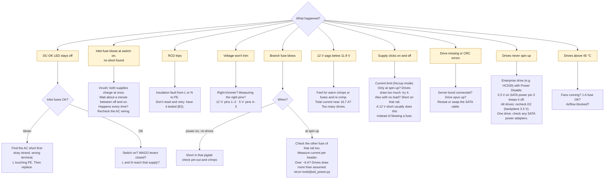

# 5. Commissioning Checklist

Print this and tick each box. **Stop at the first failure** and fix it before you go on. Record your readings in the [test log](test-log.md).

> [!CAUTION]
> The cord stays **unplugged** for parts A, B and B2. Read [SAFETY.md](../SAFETY.md) first.


Blue steps are done with the cord unplugged. Red steps have mains connected.

## A. Visual check (unplugged)

- [ ] No loose copper strands near any terminal
- [ ] Every ferrule and ring terminal crimped tight. Tug-test each wire, including the three push-on receptacles on the inlet.
- [ ] Stud nuts and terminal screws tight
- [ ] Colours match the [assembly guide](04-assembly-guide.md#wire-colours): brown L, blue N, green-yellow PE
- [ ] Fuses fitted: 2 × 6.3 A T in the inlet, 2 × 7.5 A and 1 × 1 A in the fuse block, 2 × 5 A inline
- [ ] AC terminals of both supplies covered (terminal cover or polycarbonate sheet)
- [ ] **No drives and no backplane connected**

## B. Resistance checks (unplugged)

Multimeter in Ω mode. Plug the cord into the inlet but **not into the wall**, and measure at the cord's plug pins, so the cord is included. First touch the two probes together and note the reading; subtract it from every low-resistance reading below.

| ✓ | Measure between | Expect | Reading |
|---|---|---|---|
| ☐ | Plug PE pin ↔ RSP-200-12 metal case | ≤ 0.3 Ω | |
| ☐ | Plug PE pin ↔ LRS-150F-5 metal case | ≤ 0.3 Ω | |
| ☐ | Plug PE pin ↔ enclosure body, and ↔ enclosure lid | ≤ 0.3 Ω | |
| ☐ | Plug PE pin ↔ negative bus (0 V–PE bond) | ≤ 0.3 Ω | |
| ☐ | Plug L pin ↔ PE pin (switch **on**) | open / very high | |
| ☐ | Plug N pin ↔ PE pin (switch **on**) | open / very high | |
| ☐ | Plug L pin ↔ N pin (switch **on**) | not a short: above 1 kΩ, often climbing as the input capacitors charge | |
| ☐ | Plug L pin ↔ N pin (switch **off**) | open | |
| ☐ | Pigtail A1: pin 1 (12 V) ↔ pin 2 (GND) | not a short (it will charge slowly through the PSU) | |
| ☐ | Pigtail A1: pin 4 (5 V) ↔ pin 2 (GND) | not a short | |
| ☐ | Pigtail A2: same two checks | not a short | |

**Backplane check** (backplane on its own, no pigtails, no drives):

| ✓ | Measure between | Result | Reading |
|---|---|---|---|
| ☐ | Header A1 pin 1 ↔ header A2 pin 1 | ≈ 0 Ω: **shared planes**, as the design assumes. Open: **split**, each header feeds its own bays | |
| ☐ | Header A1 pin 4 ↔ header A2 pin 4 | as above | |
| ☐ | Header A1 pin 1 ↔ pin 2, and pin 4 ↔ pin 2 | not a short | |

Record whether the planes are shared or split. Shared: a single blown fuse goes unnoticed, so after any fault check **both** fuses of that rail ([why](01-design-overview.md#why-each-part-is-there)). Split: each header carries 4 drives, so a blown fuse takes 4 drives offline. The fuse ratings stay the same either way.

## B2. Safety test by an electrician (unplugged)

A multimeter can't tell a good earth from a marginal one, and it can't test insulation at mains voltage. Before the first plug-in, have an electrician test the finished unit as a Class I appliance (in Switzerland to SNR 462638, elsewhere e.g. EN 50678 / VDE 0701-0702). Typical limits:

| ✓ | Test | Limit | Result |
|---|---|---|---|
| ☐ | Protective-earth resistance, plug PE pin to every metal part | ≤ 0.3 Ω (cord up to 5 m) | |
| ☐ | Insulation resistance, L + N to PE, switch on | ≥ 1 MΩ | |
| ☐ | Protective-conductor (leakage) current | ≤ 3.5 mA | |

## C. First power-on, no load

- [ ] Plug the cord into a socket protected by a **30 mA RCD** (FI-Schutzschalter). The lid may stay off, but keep your hands away from the supplies.
- [ ] Switch the inlet **on**
- [ ] Both green **DC-OK** LEDs light
  - If not: switch off, unplug, and check the inlet fuses and the AC wiring
- [ ] No smell, no noise other than a faint whine, nothing gets warm

After switching off, **wait about a minute before switching on again**. The supplies limit their switch-on (inrush) current with a thermistor that only works when it is cold, so switching off and on in quick succession lets a much bigger inrush through, which can blow the inlet fuses.

## D. Trim the voltages (no load)

Use the **insulated trimming tool**, with the AC terminals covered. Hold the multimeter probes with one hand, or clip them on.

Measure at the **pigtail connector** with the multimeter in DC V:

| ✓ | Rail | Probe on pins | Turn trimmer | Target | Reading |
|---|---|---|---|---|---|
| ☐ | +12 V, A1 | 1 (+) and 2 (−) | **V.ADJ** on RSP-200-12 | **12.15 V** | |
| ☐ | +12 V, A2 | 1 and 2 | (no adjustment, check only) | 12.15 V ± 0.02 | |
| ☐ | +5 V, A1 | 4 (+) and 3 (−) | **V.ADJ** on LRS-150F-5 | **5.15 V** | |
| ☐ | +5 V, A2 | 4 and 3 | (no adjustment, check only) | 5.15 V ± 0.02 | |
| ☐ | Fan circuit | fan red ↔ black | (fans running) | ≈ 12.15 V | |

- [ ] Switch off, **unplug**, and wait 1 minute until both LEDs are dark

## D2. Backplane check (no drives)

Some backplanes make their own 3.3 V. On an enterprise drive with Power Disable (PWDIS), like the HC530, 3.3 V on SATA power pin 3 keeps the drive switched off.

1. [ ] Plug both pigtails into the backplane's **A1** and **A2** headers. **No drives.**
2. [ ] Plug in and switch on
3. [ ] On one bay's SATA power connector, measure every pin against ground: probe the solder joints on the back of the backplane, or use a thin probe tip in the connector

| ✓ | Check | Expect | Reading |
|---|---|---|---|
| ☐ | Pins at 12 V | ≈ 12.15 V | |
| ☐ | Pins at 5 V | ≈ 5.15 V | |
| ☐ | Any pin at about 3.3 V (or any value other than 0, 5 or 12 V) | **none**. If one is: the backplane drives PWDIS, so HC530s will stay off. Stop and investigate. | |

4. [ ] Switch off and unplug

## E. First spin-up (test drives)

> [!WARNING]
> **Check your test drives first.** Old, cheap drives are ideal for testing, but many draw far more at spin-up than the HC530's 1.27 A. Look for "startup" or "spin-up" current in each model's datasheet (the label only shows running current) and run:
>
> ```sh
> python3 tools/jbod_power.py --spinup-12v 2.5   # replace 2.5 with your test drive's figure
> ```
>
> Eight drives at 2.5 A need 20 A, more than the RSP-200-12's 16.7 A, and more than the 18 AWG pigtails' fuses allow. The supply would shut down and restart over and over during spin-up. If you don't know the figure, **start with 4 drives**, measure the peak, then add more.

**Expected peak** = number of drives × the drive's spin-up current. For 8 HC530s: 8 × 1.27 = 10.2 A. Write your figure here: ________ A.

1. [ ] Insert the test drives (4 first if you don't know their spin-up current). Pigtails stay in **A1** and **A2**.
2. [ ] Connect the **server bond wire** to a bare-metal screw on the server chassis. The server can stay off for this test. Connect it **before** any SATA data cable.
3. [ ] Put the enclosure lid on.
4. [ ] Set the clamp meter to **DC A, 20 A range** and **zero it** (press ZERO with the jaws closed and away from wires). Clamp it around **both yellow pigtail wires together**, outside the enclosure. Together they carry the whole drive load on 12 V (the fans have their own fuse).
5. [ ] Back-probe pigtail A1 pins 1 (+) and 2 (−) with the multimeter, and set it to **MIN/MAX**
6. [ ] Plug in and switch on, then watch. Repeat the spin-up with the multimeter on pins 4 (+) and 3 (−) for the 5 V reading. Switch off and wait about a minute between runs.

| ✓ | Check | Expect | Reading |
|---|---|---|---|
| ☐ | 12 V current during spin-up (highest reading) | ≈ your expected peak. **Stop if above 11.9 A** (75 % of 16.7 A = 12.5 A, minus 0.6 A for the fans, which this clamp position doesn't see) | |
| ☐ | 12 V current in one yellow wire only (clamp A1, then A2) | ≈ half of the total if the planes are shared. **Must stay below 7.5 A** | |
| ☐ | 12 V MIN during spin-up | ≥ 11.90 V | |
| ☐ | 5 V MIN | ≥ 5.00 V | |
| ☐ | 12 V current after ~15 s (idle) | ≈ number of drives × idle current (8 HC530s: ≈ 3.2 A) | |
| ☐ | All drives spin up (listen, or check the activity LEDs) | all | |
| ☐ | Fans running | both | |
| ☐ | After 30 min: PSU cases, fuses and crimps | ≤ 50 °C (IR thermometer, or you can keep your hand on it for 10 s) | |

The clamp meter updates only a few times per second, so it may read slightly below the true spin-up peak.

## F. Host test

1. [ ] Check that the **server bond** is still connected. Then connect the SATA data cables to the host.
2. [ ] Power on in order: **JBOD first**, wait ~15 s, then the host (see [power-on order](01-design-overview.md#power-on-and-power-off-order))
3. [ ] All drives detected. Record SMART attributes **199** (UDMA CRC errors) and **194** (temperature) for each drive as a baseline: `smartctl -A /dev/sdX`
4. [ ] Read from all drives for 30 min, e.g. `badblocks -sv /dev/sdX` (read-only by default) on each test drive
5. [ ] Attribute 199 has not increased on any drive
6. [ ] Drive temperature (194) after 30 min of reading: **≤ 45 °C** (the HC530's limit is 60 °C)

✅ **Commissioning complete.** Fill in the [test log](test-log.md). When the HC530s replace the test drives, repeat parts E and F with them.

## If something goes wrong

**Unplug before you investigate.** Start from the symptom:


