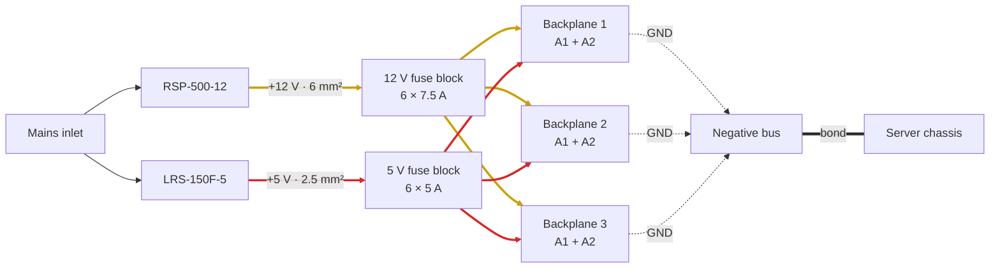
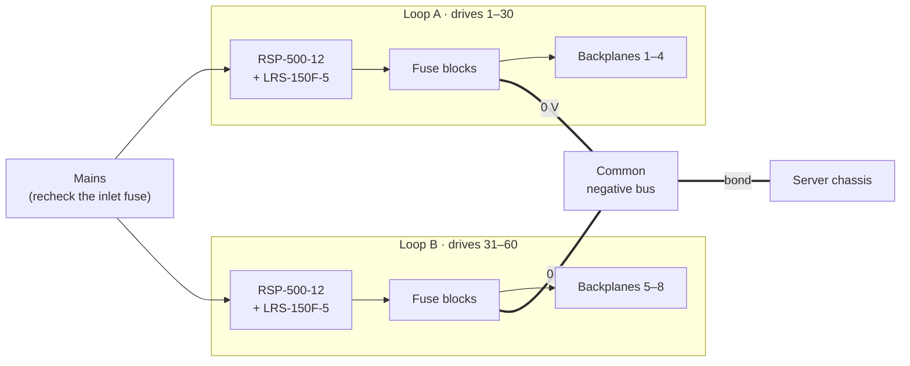

# 6. Scaling Up

How to go beyond 8 drives. This is a planning guide: it is even less tested than the 8-drive build. Use `tools/jbod_power.py` for your exact numbers.

## How many drives per supply?

With the 75 % derating target and the default drive figures (1.27 A spin-up, 0.40 A idle, 0.47 A at 5 V):

| Supply | All drives spin up at once | Staggered spin-up, in groups of 8 |
|---|---|---|
| RSP-200-12 (16.7 A) | **9** | ~13 |
| RSP-500-12 (41.7 A) | **24** | ~60 |
| LRS-150F-5 (22 A, 5 V) | **35** | 35 (5 V doesn't surge) |

> [!WARNING]
> The original worksheet said "30 drives per RSP-500-12 at 75 % load". That is **wrong**: 30 × 1.27 A = 38.1 A, which is **91 %** at spin-up. It is still under the rating, but there is no margin left for higher-current drives or an aging supply. Use 24, or stagger the spin-up.

### Staggered spin-up

The Jonsbo N3 powers all its bays at once. To stagger the spin-up you need drives and a controller that support it:

- **PUIS** (Power-Up In Standby): the drive stays spun down until the host tells it to spin up. Your HBA or OS then spins drives up one at a time or in groups. Many drives support it, but some need a jumper or `hdparm -s1`. Check yours, and test that your controller really does spin them up.
- **SAS backplanes or HBAs** with delayed or staggered spin-up.

The peak load with staggering is roughly `idle × (drives − group) + spin-up × group`. For 30 drives in groups of 8: 0.40 × 22 + 1.27 × 8 ≈ 19 A, which is 45 % of an RSP-500-12.

## A 24-drive build (3 backplanes)

Each arrow from a fuse block to a backplane is two fused leads, one per Molex header.

| Change from the 8-drive build | Why |
|---|---|
| **RSP-500-12** replaces the RSP-200-12 | 30.5 A peak (73 %) |
| **6 mm² wire** (or two 2.5 mm² in parallel from separate V+ terminals) for the 12 V feed and its V− return | 30 A is more than 2.5 mm² is rated for (about 24 A) |
| M5 rings for 6 mm² on the fuse block studs | Matches the wire |
| 12 V fuses: still **7.5 A per header**, now 6 positions on the Blue Sea 5026 | Each backplane still carries 8 drives |
| 5 V: one LRS-150F-5 is still enough (11.3 A, 51 %) | Use a **second blade fuse block** as the 5 V bus instead of 6 inline holders |
| 5 V feed: 2.5 mm² is still fine | 11.3 A |

## 60 drives (two independent loops)

Build two complete loops, each with **one RSP-500-12 + one LRS-150F-5** serving up to 30 drives (staggered spin-up) or 24 (all at once).

No wire ever connects Loop A's +12 V or +5 V to Loop B's. Only the 0 V side is shared.

Rules:

1. **Each backplane is fed by exactly one loop.** Never connect two supplies to the two headers of one backplane.
2. **Tie the negative buses of both loops together** and bond them to the server, so everything shares one 0 V.
3. **Recheck the mains side.** Two RSP-500-12 plus two LRS-150F-5 can draw over 1 kW at peak (≈ 5 A at 230 V). The 6.3 A inlet fuses would then run close to their rating. Recalculate the inlet fuse and cord rating, and consider separate inlets per loop.
4. The RSP-500-12 has a **remote on/off** input (connector CN100). It could be used to switch the 12 V supply from the server's PS_ON signal through an isolating relay or optocoupler. Check the RSP-500 datasheet for the pinout and logic levels before you wire it.

Back to the [README](../README.md)
