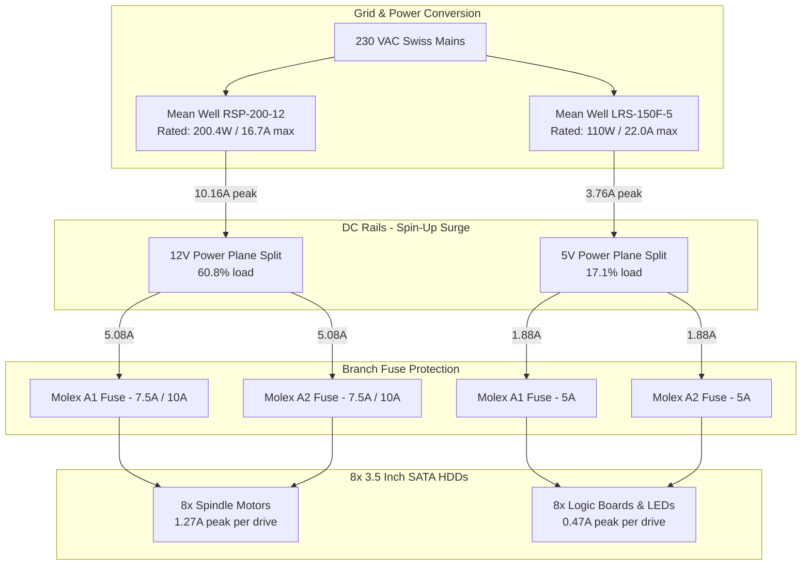

# JBOD Power: Electrical Calculations & Fusing Specifications

This document details the engineering calculations, load margins, fuse sizing, wire cross-section selection, and ground-bonding architecture for the DIY JBOD power system based on the **Mean Well RSP-200-12**, **RSP-500-12**, and **LRS-150F-5**.

---

## 1. Hard Drive Power Profile & Spin-Up Dynamics

Hard disk drives (HDDs) exhibit two drastically different power states:
1. **Spin-Up Phase (First 3 to 10 seconds):** Spindle motors accelerate from 0 to 7200 RPM, drawing a high peak inductive surge current almost exclusively on the **+12 V rail**.
2. **Idle / Sustained Read-Write:** Spindle motor current drops significantly; power is consumed continuously by the voice-coil actuator and onboard logic on both the **+12 V** and **+5 V rails**.

### Measured & Datasheet Ratings (Per 3.5" HDD)
* **12 V Spin-Up Peak Current:** 1.27 A (15.24 W)
* **12 V Idle / Operating Current:** approx. 0.35 A to 0.45 A (4.2 W - 5.4 W)
* **5 V Logic Current:** 0.47 A (2.35 W) sustained peak

---

## 2. Load Calculations: 8-HDD Proof of Concept (PoC)

For the 8-bay Jonsbo N3 backplane setup:

$$\text{Peak 12 V Current} = 8 \times 1.27\text{ A} = \mathbf{10.16\text{ A}}\quad (121.9\text{ W})$$
$$\text{Peak 5 V Current} = 8 \times 0.47\text{ A} = \mathbf{3.76\text{ A}}\quad (18.8\text{ W})$$
$$\text{Total Combined Peak Power} = 121.9\text{ W} + 18.8\text{ W} = \mathbf{140.7\text{ W}}$$

### Power Supply Sizing & Headroom

| Rail | Max Load | Selected Supply | Rated Output | Load Ratio | Headroom Margin |
|---|---|---|---|---|---|
| **+12 V Spindle** | **10.16 A** | **Mean Well RSP-200-12** | 16.7 A (200.4 W) | **60.8%** | **39.2% Safety Margin** |
| **+5 V Logic** | **3.76 A** | **Mean Well LRS-150F-5** | 22.0 A (110.0 W) | **17.1%** | **82.9% Safety Margin** |



* **Analysis:** Industrial power supplies are rated for continuous 24/7 duty at 100% capacity. Operating the **RSP-200-12** at ~61% peak spin-up and <25% idle means the power supply will generate very little heat, maintain high MTBF, and run completely silent without aggressive fan curves.

---

## 3. Fuse Selection & Sizing

The Jonsbo N3 backplane features two 4-pin Molex headers (`Molex A1` and `Molex A2`). Because all 12 V pins and 5 V pins connect to common internal copper planes, current divides equally between the two input connectors.

### 12 V Rail Fusing
* **Normal Spin-Up Load per Header:** 10.16 A / 2 = **5.08 A** per connector.
* **Continuous Operating Current per Header:** approx. 1.8 A.
* **Selected Fuse:** **7.5 A (or 10 A) fast-acting ATO/ATC blade fuse** (Littelfuse Series 257).
  * *Why 7.5 A / 10 A?* Standard automotive blade fuses can carry 110% of rated load indefinitely, 135% for up to 1800 seconds, and 200% for 0.15 to 5 seconds. A 7.5 A or 10 A fuse easily absorbs the 5.08 A inrush transient while reliably blowing during a genuine hard short before the 18 AWG pigtail wire reaches insulation melting temperature.

### 5 V Rail Fusing
* **Normal Load per Header:** 3.76 A / 2 = **1.88 A** per connector.
* **Selected Fuse:** **5 A fast-acting ATO/ATC blade fuse**.
  * *Why 5 A?* Provides tight overcurrent protection for backplane trace protection and logic boards while easily handling the sub-2 A demand.

---

## 4. Wire Gauge & Voltage Drop Analysis

Voltage drop across wiring is calculated using Ohm's Law:

$$\Delta V = 2 \times I \times \frac{\rho \cdot L}{A}$$

Where $\rho$ is the resistivity of copper ($0.0175\ \Omega\cdot\text{mm}^2/\text{m}$), $L$ is wire length in meters, and $A$ is the conductor cross-section in $\text{mm}^2$.

| Cable Section | Current | Wire Gauge | Length | Voltage Drop ($\Delta V$) | Margin & Purpose |
|---|---|---|---|---|---|
| **PSU to Fuse Block (+12V)** | 10.2 A | 2.5 mm2 (H07V-K) | 0.5 m | **0.07 V** | Negligible drop. Ampacity rated 24 A. |
| **Fuse Block to Molex (12V)** | 5.1 A | 0.82 mm2 (18 AWG) | 0.2 m | **0.04 V** | Safe inside 5% SATA tolerance. |
| **PSU to WAGO (+5V)** | 3.8 A | 2.5 mm2 (H07V-K) | 0.5 m | **0.03 V** | Negligible drop. |
| **WAGO to Molex (5V)** | 1.9 A | 0.82 mm2 (18 AWG) | 0.2 m | **0.02 V** | Safe inside 5% SATA tolerance. |
| **Central Ground Return (V-)** | 14.0 A combined | 6.0 mm2 (H07V-K) | 0.5 m | **0.04 V** | Heavy copper keeps ground bounce near zero. |

### Trimming Recommendations
To completely cancel out wire and backplane resistance:
* **Tune 12 V PSU trimmer `SVR1` to:** **12.15 V** (so drives receive 12.05 V at full spin-up).
* **Tune 5 V PSU trimmer `VR1` to:** **5.15 V** (so drives receive 5.05 V at full load).

---

## 5. Ground Reference & Server-GND Bonding

```
 [JBOD Power Supplies]                   [Host Server / Motherboard]
  RSP-200-12 (V-) ──┐
  LRS-150F-5 (V-) ──┴──> [Blue Sea Negative Bus]
                                │
                                └─── 6.0 mm2 Black Wire ───> [Server Chassis / PCIe Bracket Ground]
```

* **Why Dedicated Server-GND is Essential:**  
  SATA high-speed differential pairs (Gen 3, 6 Gb/s) and sideband lines rely on a shared 0 V DC potential between the storage drives and the host SATA controller. Without a heavy low-impedance ground bonding wire between the JBOD negative bus and the server chassis, any tiny ground loop or floating DC offset would force return currents through the thin shield wires of the SATA data cables, causing PHY bit errors, dropped links, or hardware damage.

---

## 6. Scale-Up Calculation with Mean Well RSP-500-12 (30 to 60 Drives)

When scaling up as calculated in your original spreadsheet:
* **Per 30 HDDs:**
  * Peak 12 V Current: $30 \times 1.27\text{ A} = \mathbf{38.1\text{ A}}\ (457.2\text{ W})$.
  * Sustained 12 V Current: $\approx 12.0\text{ A}$ ($144\text{ W}$).
  * Powered by: **1x Mean Well RSP-500-12** (12 V / 41.7 A, 500.4 W).
  * Load at spin-up: $38.1\text{ A} / 41.7\text{ A} = \mathbf{91.4\%}$ momentary surge, dropping to **28.8%** sustained operating load.
* **For 60 HDDs Total:**
  * Two isolated loops, each powered by **1x RSP-500-12** (12V) + **1x LRS-150F-5** (5V).
  * Built-in Remote ON/OFF (`RC` / `RCG`) on the RSP-500-12 allows motherboard PS_ON logic switching.
