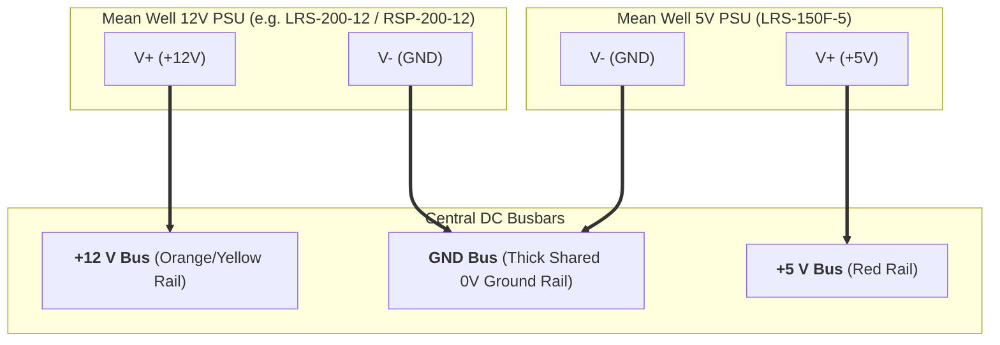
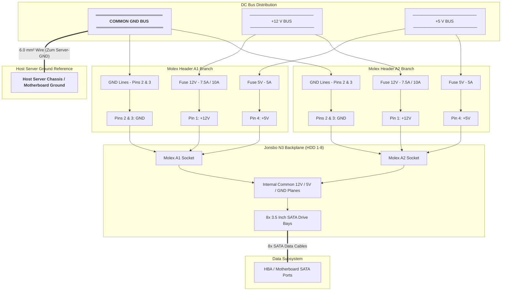

# Original Power Calculations & Schematic (Digitized from Worksheet)

This document is the digitized, clean markdown version of the original design sheet (`power_calculation_sheet.pdf`), containing the raw drive power metrics, power supply sizing tables, and the original busbar wiring schematics.

---

## 1. Per-Drive Power Profile & 10-HDD Baseline Calculation

The original baseline calculations were modeled against a **10-HDD reference array** using measured spin-up and logic draw:

| Metric | +5 V Rail (Logic) | +12 V Rail (Spindle Motor) | Total Combined |
|---|---|---|---|
| **Spin-up Current per HDD** | **0.47 A** | **1.27 A** | — |
| **Power per HDD** | **2.35 W** ($5\text{ V} \times 0.47\text{ A}$) | **15.24 W** ($12\text{ V} \times 1.27\text{ A}$) | **17.59 W / HDD** |
| **Total Current (10 HDDs)** | **4.70 A** | **12.70 A** | — |
| **Total Wattage (10 HDDs)** | **23.50 W** | **152.40 W** | **175.90 W** |

*Note: For the 8-HDD PoC build, the actual peak spin-up is $8 \times 1.27\text{ A} = \mathbf{10.16\text{ A}}\ (121.9\text{ W})$ on 12 V and $8 \times 0.47\text{ A} = \mathbf{3.76\text{ A}}\ (18.8\text{ W})$ on 5 V.*

---

## 2. Power Supply Sizing Matrix (at 75% Continuous Load Target)

To prevent premature aging and ensure cool, reliable operation, the target design derates power supplies to **$\le 75\%$ of maximum rated wattage**:

| Power Supply Model | Output Voltage | Rated Current | Rated Power | Price Reference | Max Sizing Load (75%) | Max HDDs per PSU | Output Terminals (V+) | HDDs per V+ Terminal (using 2 V+) |
|---|---|---|---|---|---|---|---|---|
| **Mean Well RSP-200-12** | 12 V | 16.7 A | 200.4 W | ~CHF 46.95 | **150.3 W** | **10 HDDs** | 3 | 5 HDDs |
| **Mean Well RSP-500-12** | 12 V | 41.7 A | 500.4 W | ~CHF 81.84 | **375.3 W** | **30 HDDs** | 3 | 15 HDDs |
| **Mean Well LRS-200-12 (PoC)** | 12 V | 17.0 A | 204.0 W | ~CHF 26.50 | **153.0 W** | **10 HDDs** | 3 | 5 HDDs |
| **Mean Well LRS-150F-5** | 5 V | 22.0 A | 110.0 W | ~CHF 27.90 | **82.5 W** | **36 HDDs** | 2 | 18 HDDs |

---

## 3. Backplane Reference Specifications

| Hardware Component | Supported HDDs | Power Inputs (Molex) | Data Ports (SATA) | Unit Price Reference |
|---|---|---|---|---|
| **Jonsbo N3 Backplane** | **8 HDDs** (3.5" SATA) | **2x 4-Pin Molex (LP4)** | **8x SATA 7-pin data** | ~CHF 11.00 (OEM) / ~CHF 75.– (Spare PCB) |

---

## 4. Power Supply to Busbar Architecture (Page 1 Diagram)

This diagram visualizes how the dual industrial power supplies interface with the main DC busbars:

---

## 5. Detailed Circuit & Fusing Schematic (Page 2 Diagram)

This schematic represents the exact wiring layout from the original worksheet, showing branch fusing on every Molex power rail, the host server ground reference, and SATA data interconnects.

### Legend
* `●` = Connected junction (electrical node)
* `+` = Crossing wires (no electrical connection)
* `▭` = Fast-acting blade fuse

---

## 6. Key Design Notes from the Original Sheet

1. **Dual Molex Balancing:** Because the backplane ties both Molex sockets to common copper planes, both headers share the spin-up current equally (~5.08 A per 12 V pin, ~1.88 A per 5 V pin).
2. **Dedicated Fuse per Molex Pin:** Fusing each line individually (`▭` in the schematic) protects against an insulation fault on any single harness wire without taking down the entire system.
3. **Dedicated "Zum Server-GND":** The direct bonding link between the central GND bus and the server chassis prevents ground loops and eliminates DC voltage offsets between the drives and the SATA host controller.
