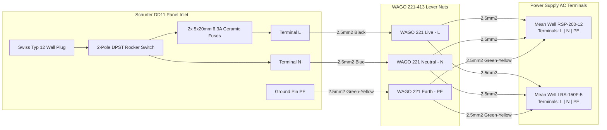
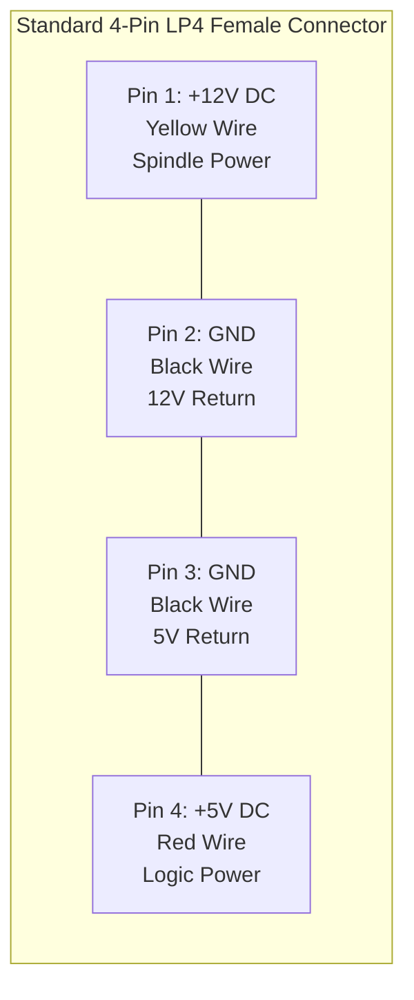
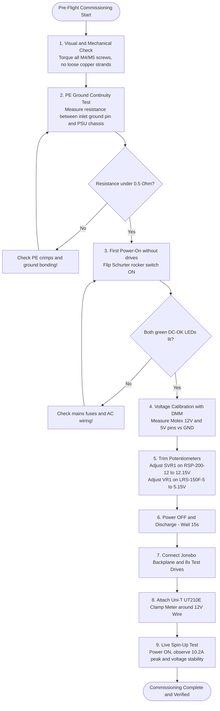

# JBOD Power: Wiring, Assembly & Commissioning Guide

> [!CAUTION]
> ### EXPERIMENTAL & UNTESTED DESIGN - PROCEED AT YOUR OWN RISK
> This guide outlines a **theoretical, currently UNTESTED proof-of-concept setup**. The author has **not yet physically assembled or tested this circuit**. Mains electricity (230 VAC) is lethal. The author and contributors accept **no liability or responsibility** for any equipment damage, data loss, fire, personal injury, or death resulting from the use or misuse of this information. Proceed strictly at your own risk.

Step-by-step assembly, wiring diagrams, and pre-flight commissioning checklist for the 8-HDD benchtop JBOD power system using the **Mean Well RSP-200-12** and **Mean Well LRS-150F-5**.

---

## Required Tools & Materials

* **Hand Tools:** Wire strippers (0.5 to 6.0 mm2), Phillips screwdriver (#2), slotted screwdriver (for Mean Well screw terminals), hex socket/wrench (8 mm for Blue Sea M5 studs).
* **Crimpers:** Wire ferrule crimper (square profile recommended for WAGO spring clamps).
* **Consumables:** Dual-wall heat shrink tubing with inner adhesive, cable ties, heat gun or lighter.
* **Meters:** Digital Multimeter (DMM) with DC voltage resolution to 0.01 V, and Uni-T UT210E DC clamp meter.

---

## Phase 1: Physical Mounting & Safety Prep

1. **Mounting Baseboard:**  
   Secure the two Mean Well power supplies and the Blue Sea 5026 fuse block onto an insulating mounting board (a 300x200 mm piece of 3 mm acrylic, phenolic board, or scrap plywood). Never run live supplies loose on a metal desk.
2. **Universal AC Input (RSP-200-12 & LRS-150F-5):**  
   Both the **Mean Well RSP-200-12** and the **LRS-150F-5** feature built-in universal full-range AC input (88-264 VAC) with active power factor correction (PFC). There are **no manual 115V/230V selector switches** to worry about; both supplies automatically adapt to Swiss 230 VAC mains.

---

## Phase 2: AC Mains Wiring (230 VAC)

1. **Inlet Preparation:** Install two 6.3 A or 10 A slow-blow (5x20 mm) ceramic fuses into the Schurter `4301.1401` fusedrawer and slide it into the Schurter `DD11` inlet.
2. **Terminal Leads:** Crimp 6.3 mm Faston receptacles onto three short lengths of 2.5 mm2 H07V-K wire from the inlet terminals (`L`, `N`, `PE`).
3. **WAGO 221 Splitting:**
   * Insert Live (`L`) into a 3-way WAGO 221 lever nut, then run branch wires to terminal `L` on both power supplies.
   * Insert Neutral (`N`) into a 3-way WAGO 221 lever nut, then run branch wires to terminal `N` on both power supplies.
   * Insert Earth (`PE`) into a 3-way WAGO 221 lever nut, then run green-yellow branch wires to the `PE` / chassis ground terminals on both power supplies.
4. Crimp insulated wire ferrules on all wire ends entering the WAGO lever nuts and Mean Well screw clamps.

---

## Phase 3: DC Distribution & Pigtail Wiring

### 1. Pre-Crimped Molex Pigtails
Take the two **InLine 33445** Molex 4-pin Y-cables. Cut them cleanly in half. Strip 8 mm of insulation from the four wires on each female connector pigtail:

* **Pin 1 (Yellow):** +12 V
* **Pin 2 (Black):** Ground
* **Pin 3 (Black):** Ground
* **Pin 4 (Red):** +5 V

### 2. +12 V Rail Wiring
* Run a 2.5 mm2 wire from RSP-200-12 `V+` terminal (crimped with an M4 ring terminal) to the positive input stud (M5) of the Blue Sea 5026 fuse block (crimped with an M5 ring terminal).
* Insert two **7.5 A (or 10 A) ATO blade fuses** into slots 1 and 2 of the Blue Sea block.
* Connect the Yellow (+12 V) wire of Molex A1 to branch screw 1 (using an M4 ring terminal).
* Connect the Yellow (+12 V) wire of Molex A2 to branch screw 2.

### 3. +5 V Rail Wiring
* Run a 2.5 mm2 Red wire from LRS-150F-5 `V+` terminal (M4 ring terminal) into a 3-way WAGO 221 lever nut.
* Connect the Red (+5 V) wire of Molex A1 into the WAGO nut through an inline 5 A fuse holder.
* Connect the Red (+5 V) wire of Molex A2 into the WAGO nut through an inline 5 A fuse holder.

### 4. DC Ground Return & Host Server Bonding
* Run a heavy 6.0 mm2 Black wire from RSP-200-12 `V-` to the Blue Sea negative ground bus (M5 stud).
* Run a 6.0 mm2 Black wire from LRS-150F-5 `V-` to the Blue Sea negative ground bus (M5 stud).
* Connect the four Black ground wires from the two Molex pigtails to branch screws on the Blue Sea negative ground bus.
* **Server-GND Connection:** Crimp an M5 ring terminal onto one end of a 6.0 mm2 Black wire and bolt it to the Blue Sea negative bus. Terminate the other end with an M4 ring terminal and fasten it directly to an unpainted screw on your host server chassis / motherboard bracket.

---

## Phase 4: Pre-Flight Commissioning Checklist (NO Drives Connected)

> [!IMPORTANT]
> **Never connect hard drives on initial power-on.** Always measure and tune the unloaded voltages first.

1. [ ] **Visual Inspection:** Verify no stray copper strands are bridging terminals. Check that all ring terminal screws are torqued down snugly.
2. [ ] **PE Continuity:** With a multimeter in continuity/resistance mode, verify zero ohms (<0.5 Ohm) between the Schurter inlet ground pin and the metal casings of both power supplies.
3. [ ] **Initial AC Power-On:** Plug in the Schurter Swiss power cable. Flip the Schurter rocker switch ON. The green DC-OK LEDs on both power supplies should illuminate.
4. [ ] **12 V Rail Trimming:**
   * Place multimeter probes on the Yellow (+12 V) and Black (GND) pins of Molex connector A1.
   * Using a small screwdriver, gently adjust trimmer `SVR1` on the RSP-200-12 until the meter reads **12.15 V**.
5. [ ] **5 V Rail Trimming:**
   * Place multimeter probes on the Red (+5 V) and Black (GND) pins of Molex connector A1.
   * Adjust trimmer `VR1` on the LRS-150F-5 until the meter reads **5.15 V**.
6. [ ] **Power OFF:** Switch off the mains inlet. Wait 15 seconds for the filter capacitors to discharge and the green LEDs to extinguish.

---

## Phase 5: Live 8-HDD Spin-Up Test

1. Connect both 4-pin Molex headers securely into the Jonsbo N3 backplane.
2. Insert 8 sacrificial/test 3.5" SATA hard drives into the drive bays.
3. Clamp the **Uni-T UT210E clamp meter** (set to 2.000 A DC range, zeroed) around the main 12 V wire entering the backplane.
4. Connect multimeter probes to monitor 12 V and 5 V rail voltages.
5. **Switch ON:**
   * Observe spin-up surge on the clamp meter: Expect approximately 10.2 A total 12 V peak.
   * Observe rail stability on the DMM: The 12 V rail should not drop below 11.90 V, and the 5 V rail should remain above 5.00 V.
   * After 8-10 seconds, the drives will reach operational speed, and 12 V current will settle down to approximately 3.0 A - 3.5 A idle.
