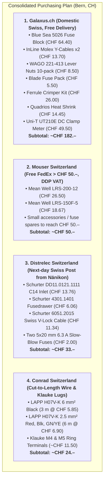

# DIY JBOD Power Project: Final 8-HDD PoC Procurement & Assembly Guide
**Date / Status:** October 2026 — Finalized for 8-HDD Benchtop Proof of Concept  
**Destination:** Bern, Switzerland (230 VAC / 50 Hz, Swiss Typ 12/13 outlet)  
**Test Setup:** 1x Jonsbo N3 Backplane (8 bays, 2x Molex), 8x 3.5" SATA HDDs, 1x Mean Well LRS-200-12, 1x Mean Well LRS-150F-5.  
*(HBA, SAS expander, and redundant scale-up busbars deferred to 40–60 drive build).*

---

## 1. Verified Electrical Specifications & Settings

| Rail | 8-HDD Spin-up Load | PSU Model | PSU Rated Output | Peak Load % | Trimmer Setting & Notes |
|---|---|---|---|---|---|
| **+12 V Rail** | **10.16 A (121.9 W)** | **Mean Well LRS-200-12** | 17.0 A (204.0 W) | **59.6%** | Trim `SVR1` to **12.15 V** (compensates for wire drop during spin-up). ⚠️ **Set red slide switch on PSU to 230 V!** |
| **+5 V Rail** | **3.76 A (18.8 W)** | **Mean Well LRS-150F-5** | 22.0 A (110.0 W) | **17.1%** | Trim `VR1` to **5.15 V** so backplane delivers clean 5.00 V under load. |
| **Combined** | **140.7 W peak** | Dual Supply | 314.0 W total | **44.8%** | Runs cool, quiet, and well within safe continuous margins. |

### Wiring & Fusing Architecture (from Schematic)
* **Molex A1 & A2 (12 V lines):** Protected by **2x 7.5 A (or 10 A) fast-acting ATO/ATC blade fuses** (each line carries ~5.08 A peak spin-up).
* **Molex A1 & A2 (5 V lines):** Protected by **2x 5 A fast-acting ATO/ATC blade fuses** (each line carries ~1.88 A peak).
* **Grounding:** Common ground reference between both PSUs. A **6.0 mm² black wire** runs from the Blue Sea negative ground bus directly to the host server/motherboard chassis ground screw ("Zum Server-GND") to keep SATA signaling references identical.
* **Mains AC Distribution:** Uses three **WAGO 221-413 (3-conductor lever nuts)** for Live, Neutral, and Earth (PE) branching from the Schurter C14 inlet to both PSUs. Eliminates expensive DIN-rail mounting.
* **5 V Distribution:** Handled cleanly through a **WAGO 221-413 lever nut** branching the 5 V PSU feed to the two Molex leads. Eliminates unnecessary industrial DIN blocks.
* **Ground Bus:** Handled directly on the **Blue Sea 5026's integrated negative ground bus** (M5 stud + 12 terminal screws). Eliminates separate 150 A copper busbars for the 8-drive stage.

---

## 2. Final Bill of Materials (BOM) with Purpose for Every Item

### Group 1: Power Supplies (Mouser Switzerland)
*Authorized Mean Well distributor, free FedEx Express shipping over CHF 50.–, DDP Swiss VAT.*

| Item | MPN / Part Number | Shop Link | Qty | Price (CHF) | Reason Needed for 8-HDD Test |
|---|---|---|---|---|---|
| **12 V Main PSU** | `LRS-200-12` | [Mouser CH — LRS-200-12](https://www.mouser.ch/ProductDetail/MEAN-WELL/LRS-200-12) | 1 | **CHF 26.50** | Powers spindle motors for all 8 drives (10.2 A spin-up surge). Runs at 60% load with 40% safety margin. |
| **5 V Logic PSU** | `LRS-150F-5` | [Mouser CH — LRS-150F-5](https://www.mouser.ch/ProductDetail/MEAN-WELL/LRS-150F-5) | 1 | **CHF 18.67** | Powers drive logic boards, backplane circuitry, and LEDs (3.8 A). Trimpot tunes voltage to 5.15 V. |

---

### Group 2: DC Protection, Wiring & Connectors (Galaxus / Digitec CH)
*Domestic Swiss warehouse (Wohlen AG), free delivery, Swiss MWST included.*

| Item | MPN / Part Number | Shop Link | Qty | Price (CHF) | Reason Needed for 8-HDD Test |
|---|---|---|---|---|---|
| **Fuse Block with Negative Bus** | Blue Sea Systems `5026` | [Galaxus — Blue Sea 5026](https://www.galaxus.ch) | 1 | **CHF 64.40** | Centralized, fire-safe DC distribution. Houses individual fuses for Molex lines and provides the common negative ground bus. |
| **Pre-Crimped Molex Y-Cables** | InLine `33445` (18 AWG, 20 cm) | [Galaxus — InLine 33445](https://www.galaxus.ch) | 2 | **CHF 13.70** (pair) | Cut in half to yield two factory-crimped female LP4 Molex pigtails for the backplane. Avoids purchasing an CHF 80 pin crimper. |
| **ATO/ATC Blade Fuses Assortment** | Standard Auto Blade Fuses (3A–30A) | [Galaxus / Reichelt](https://www.galaxus.ch) | 1 box | **~CHF 5.50** | Fire protection. Insert 2x 7.5A fuses on 12 V lines and 2x 5A fuses on 5 V lines. |
| **WAGO 221 Lever Nuts (3-way)** | WAGO `221-413` (Compact 3-conductor) | [Galaxus — WAGO 221-413 (10-pack)](https://www.galaxus.ch) | 1 pack | **CHF 8.50** | Simplifies all branching (Live, Neutral, PE, and 5 V rail) safely with zero tools. |
| **Wire Ferrule Crimper Kit** | Hex/Square Crimper + 1200 Ferrules | [Galaxus Ferrule Kit](https://www.galaxus.ch) | 1 kit | **~CHF 26.00** | Crimps clean ferrule ends on fine-stranded wire for WAGO clamps and screw terminals. Replaces the CHF 117 Knipex tool. |
| **Adhesive Heat Shrink Assortment** | Quadrios `1904C053` (3:1 dual-wall) | [Galaxus — Quadrios Heat Shrink](https://www.galaxus.ch) | 1 box | **CHF 14.45** | Insulates and seals ring terminal crimp barrels against shorts. |

---

### Group 3: Mains Side Hardware (Distrelec Switzerland)
*Dispatched from Nänikon (ZH) warehouse, next-day Swiss Post delivery.*

| Item | MPN / Part Number | Shop Link | Qty | Price (CHF) | Reason Needed for 8-HDD Test |
|---|---|---|---|---|---|
| **Switched/Fused IEC C14 Inlet** | Schurter `DD11.0121.1111` | [Distrelec — Schurter DD11](https://www.distrelec.ch/en/inlet-c14-250v-schurter-dd11-0121-1111/p/16963541) | 1 | **CHF 13.76** | Safe, standard mains power entry. Built-in DPST switch shuts off Live and Neutral simultaneously. |
| **2-Pole Fusedrawer** | Schurter `4301.1401` | [Distrelec — Schurter 4301.1401](https://www.distrelec.ch/en/fuse-drawer-schurter-4301-1401/p/14323371) | 1 | **CHF 6.06** | Insert drawer for DD11 inlet holding two 5x20 mm slow-blow fuses (6.3 A or 10 A). |
| **Swiss Typ 12 to C13 Cable** | Schurter `6051.2015` (V-Lock, 2.5 m) | [Distrelec — Schurter 6051.2015](https://www.distrelec.ch/en/power-cable-ch-type-t12-plug-iec-60320-c13-5m-black-schurter-6051-2015/p/11041912) | 1 | **CHF 11.34** | High-quality SEV-approved Swiss mains cable. Mechanical V-Lock latch prevents accidental disconnection. |

---

### Group 4: Cut-to-Length Wire & Terminals (Conrad Switzerland)
*Cut to exact meter lengths from Swiss warehouse.*

| Item | Part Number | Shop Link | Qty | Price (CHF) | Reason Needed for 8-HDD Test |
|---|---|---|---|---|---|
| **6.0 mm² Wire (DC & Server GND)** | LAPP `4520014` (H07V-K 6 mm² Black) | [Conrad — LAPP 6 mm² Meterware](https://www.conrad.ch/de/p/lapp-4520014-litze-h07v-k-1-x-6-mm-schwarz-meterware-603120.html) | 3 m | **CHF 5.85** | High-current feed from PSU V- to ground bus, and common ground bonding to server chassis. |
| **2.5 mm² Wire (12V, 5V, PE)** | LAPP `4520042` (Red), `4520012` (Blk), `4520002` (GN/YE) | [Conrad — LAPP 2.5 mm² Meterware](https://www.conrad.ch) | 2 m each | **CHF 6.90** | Carries 12 V and 5 V from PSUs to Blue Sea block. Green/Yellow connects PSU metal chassis to mains PE. |
| **M3.5 / M4 Ring Terminals** | Klauke `6504` (6 mm²) & `6304` (2.5 mm²) | [Conrad — Klauke Ring Terminals](https://www.conrad.ch) | 10-packs | **~CHF 8.00** | Prevents stranded wire from splaying under Mean Well screw terminals. Ensures low-resistance contact. |
| **M5 Ring Terminals** | Klauke `6505` (6 mm² / M5 hole) | [Conrad — Klauke M5 Terminals](https://www.conrad.ch) | 5 pcs | **~CHF 3.50** | Bolts 6 mm² wires securely onto the Blue Sea 5026 positive and negative M5 studs. |

---

### Group 5: Recommended Measurement Instrument

| Item | MPN / Part Number | Shop Link | Qty | Price (CHF) | Reason Needed for 8-HDD Test |
|---|---|---|---|---|---|
| **Mini DC Clamp Meter (1 mA)** | Uni-T `UT210E` True RMS | [Digitec — Uni-T UT210E](https://www.digitec.ch/de/s1/product/uni-t-ut-210e-zangenmessgeraet-5780362) | 1 | **CHF 49.50** | **Essential diagnostic tool.** Allows clamping around any single wire to measure the exact 1.27 A spin-up surge and 0.25 A idle draw without cutting wires or inserting series resistance. |

*(Note: Standard digital multimeter is assumed already on hand for basic 12.1 V / 5.15 V trimming).*

---

## 3. Order Checklists by Distributor (Click to Buy)

**Total Estimated PoC Hardware Cost:** **~CHF 289.–** (or **~CHF 339.–** including the Uni-T UT210E DC clamp meter).

---

## 4. Quick Assembly & Commissioning Checklist

1. **Bench Mounting:** Mount both PSUs and the Blue Sea fuse block to an insulating baseplate (wood board or acrylic) to prevent accidental shorts on the desk.
2. **Voltage Selector Switch:** ⚠️ Check the red slide switch on the side of the **LRS-200-12** and set it to **230 V**.
3. **Mains Wiring (Live, Neutral, Earth):**
   * From Schurter C14 inlet $\rightarrow$ connect Live to a 3-way WAGO 221 $\rightarrow$ feed `L` on both PSUs.
   * Connect Neutral to a 3-way WAGO 221 $\rightarrow$ feed `N` on both PSUs.
   * Connect Earth (PE) to a 3-way WAGO 221 $\rightarrow$ feed `PE / Ground` on both PSUs.
4. **DC Bus Wiring:**
   * Run 2.5 mm² Red from 5 V PSU `V+` into a WAGO 221 $\rightarrow$ split into Molex A1 and A2 pin 4 with inline 5 A fuses.
   * Run 2.5 mm² Yellow/Red from 12 V PSU `V+` to the Blue Sea 5026 positive stud $\rightarrow$ insert 2x 7.5 A fuses $\rightarrow$ connect branch terminals to Molex A1 and A2 pin 1.
   * Run 6.0 mm² Black from 12 V PSU `V-` and 5 V PSU `V-` to the Blue Sea negative ground bus.
   * Connect all Molex ground wires (pins 2 & 3) to the Blue Sea negative ground bus.
   * Run a 6.0 mm² Black wire from the Blue Sea negative ground bus to your test server chassis / motherboard ground screw.
5. **Pre-Flight Voltage Tuning (Before plugging in HDDs):**
   * Power on with no drives attached.
   * Measure 12 V at the Molex connector $\rightarrow$ trim `SVR1` to **12.15 V**.
   * Measure 5 V at the Molex connector $\rightarrow$ trim `VR1` to **5.15 V**.
6. **Drive Test:** Power off, insert the 8 test drives, attach the clamp meter around the 12 V wire, power on, and observe spin-up current and voltage stability.
